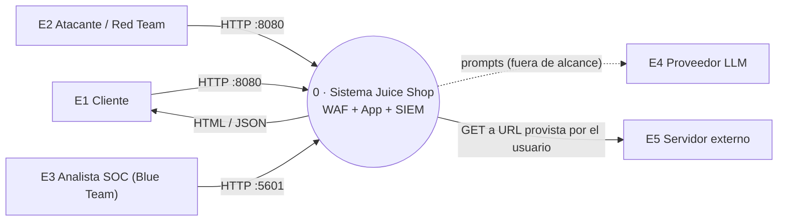
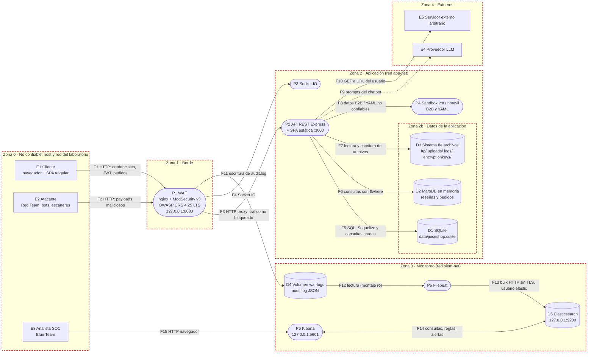

# Hito 1 - Diseño seguro - Blue Team

**Equipo Blue Team:** Juan Pablo Solís, Josué Marroquín
**Metodología:** PASTA (Process for Attack Simulation and Threat Analysis), etapas 1 a 4, con STRIDE como taxonomía de amenazas por componente
**Objeto de análisis:** OWASP Juice Shop v20.3.0 desplegado detrás del entorno `entorno-blue-team/` (ModSecurity + OWASP CRS 4.25 LTS, Filebeat, Elasticsearch y Kibana 8.19.24)
**Versión:** 1.0 · 2026-11-10

---

## Índice

1. [Contexto y método](#1-contexto-y-método)
2. [Etapa 1 · Objetivos de negocio y de seguridad](#2-etapa-1--objetivos-de-negocio-y-de-seguridad)
3. [Etapa 2 · Alcance técnico](#3-etapa-2--alcance-técnico)
4. [Etapa 3 · Descomposición de la aplicación (DFD y límites de confianza)](#4-etapa-3--descomposición-de-la-aplicación)
5. [Etapa 4 · Análisis de amenazas (STRIDE por componente)](#5-etapa-4--análisis-de-amenazas)
6. [Requisitos de seguridad](#6-requisitos-de-seguridad)
7. [Casos de abuso (Dado / Cuando / Entonces)](#7-casos-de-abuso)
8. [Trazabilidad hacia H2, H3 y H4](#8-trazabilidad-hacia-h2-h3-y-h4)
9. [Supuestos](#9-supuestos)
10. [Referencias](#10-referencias)

---

## 1. Contexto y método

OWASP Juice Shop es una tienda en línea intencionalmente vulnerable. En este proyecto la tratamos como si fuera una tienda real que el grupo debe proteger. El Blue Team es responsable de la **detección y contención en tiempo de ejecución** (WAF + SIEM) y comparte con el Red Team el pipeline DevSecOps y la remediación.

PASTA tiene siete etapas. Este hito cubre las cuatro primeras; las demás se completan en los hitos siguientes:

| Etapa PASTA | Contenido | Dónde se entrega |
|---|---|---|
| 1. Definir objetivos | Objetivos de negocio, objetivos de seguridad, impacto | **Este documento, §2** |
| 2. Definir alcance técnico | Componentes, tecnologías, dependencias, superficie | **Este documento, §3** |
| 3. Descomponer la aplicación | DFD, límites de confianza, puntos de entrada, activos | **Este documento, §4** |
| 4. Analizar amenazas | Agentes de amenaza, inteligencia, STRIDE por componente | **Este documento, §5** |
| 5. Analizar vulnerabilidades | Hallazgos del pipeline (SAST/SCA/DAST) | H2 (`docs/hito-2/`) |
| 6. Modelar ataques | PoC del Red Team, detección y bloqueo del Blue Team | H2 y H3 (`red-team/poc/`, `docs/hito-3/`) |
| 7. Análisis de riesgo e impacto | Riesgo residual tras correcciones | Informe final (`docs/informe-final/`) |

Cada amenaza de §5 tiene un ID (`T-xxx-nn`) que se reutiliza en los requisitos (§6), los casos de abuso (§7) y, más adelante, en la matriz de trazabilidad del informe final.

**Escala de riesgo usada** (cualitativa, Probabilidad × Impacto):

| | Impacto bajo | Impacto medio | Impacto alto |
|---|---|---|---|
| **Probabilidad alta** | Medio | Alto | Crítico |
| **Probabilidad media** | Bajo | Medio | Alto |
| **Probabilidad baja** | Bajo | Bajo | Medio |

La probabilidad considera que el código fuente de Juice Shop, sus retos (`data/static/challenges.yml`) y sus soluciones son públicos, por lo que un atacante tiene inteligencia completa sobre la aplicación. Por eso la mayoría de amenazas sobre la aplicación tienen probabilidad alta.

---

## 2. Etapa 1 · Objetivos de negocio y de seguridad

### 2.1 Escenario de negocio

Juice Shop no publica un modelo de negocio. Para el ejercicio asumimos el siguiente escenario, coherente con las funciones que la aplicación implementa (catálogo, carrito, pagos, billetera, membresía *deluxe*, pedidos B2B, reseñas, quejas, exportación y borrado de datos personales):

> *"Juice Shop" es una tienda de jugos en línea que vende a clientes finales (B2C) y a empresas (B2B). Los clientes se registran, guardan direcciones y tarjetas, pagan pedidos o usan su billetera, y pueden pagar una membresía deluxe. El personal de contabilidad gestiona pedidos y entregas; los administradores gestionan usuarios y contenido.*

Estos supuestos están marcados para validación del equipo en §9.

### 2.2 Objetivos de negocio

| ID | Objetivo de negocio | Funcionalidad que lo soporta |
|---|---|---|
| BO-1 | Vender productos en línea de forma continua (disponibilidad del catálogo y del checkout) | Catálogo, búsqueda, carrito, checkout (`/rest/products/search`, `/api/BasketItems`, `/rest/basket/:id/checkout`) |
| BO-2 | Mantener la confianza del cliente protegiendo sus datos personales y de pago | Cuentas, direcciones, tarjetas, exportación y borrado de datos (`/api/Users`, `/api/Addresss`, `/api/Cards`, `/rest/user/data-export`, `/dataerasure`) |
| BO-3 | Cobrar correctamente: precios, cupones, billetera y membresías sin fraude | Cupones, billetera, deluxe (`/rest/basket/:id/coupon/:coupon`, `/rest/wallet/balance`, `/rest/deluxe-membership`) |
| BO-4 | Atender clientes empresariales con pedidos B2B | `/b2b/v2/orders` |
| BO-5 | Mantener reputación de marca (reseñas y feedback auténticos, sin contenido malicioso) | Reseñas, feedback, quejas (`/rest/products/:id/reviews`, `/api/Feedbacks`, `/api/Complaints`) |
| BO-6 | Cumplir obligaciones de privacidad (estilo GDPR) y de tarjetas (estilo PCI DSS) | Exportación/borrado de datos, almacenamiento de tarjetas |

### 2.3 Objetivos de seguridad derivados

| ID | Objetivo de seguridad | Deriva de | Propiedad |
|---|---|---|---|
| SO-1 | Solo el titular puede ver o modificar su cuenta, carrito, direcciones, tarjetas y pedidos | BO-2, BO-3 | Confidencialidad, integridad |
| SO-2 | Las funciones administrativas y de contabilidad solo son accesibles a esos roles | BO-2, BO-3 | Autorización |
| SO-3 | Las credenciales y sesiones (JWT) no se pueden adivinar, robar ni falsificar | BO-2 | Autenticación |
| SO-4 | Precios, cantidades, cupones y saldos no se pueden manipular desde el cliente | BO-3 | Integridad |
| SO-5 | La entrada del usuario nunca se ejecuta como código (SQL, NoSQL, JS, plantillas, XML) | BO-1, BO-2, BO-5 | Integridad, confidencialidad |
| SO-6 | El servicio sigue disponible ante tráfico abusivo (ráfagas, escaneos, payloads costosos) | BO-1 | Disponibilidad |
| SO-7 | **Todo ataque contra la tienda queda registrado, se detecta y puede contenerse** (WAF + SIEM) | Todos | No repudio, detección |
| SO-8 | Los registros de seguridad son íntegros, no exponen secretos y permiten reconstruir una línea de tiempo | SO-7, BO-6 | Integridad, confidencialidad |

SO-7 y SO-8 son los objetivos que el Blue Team posee directamente; el resto se cumple con controles en código (H4) y se **compensa** con WAF/SIEM mientras el código no está corregido.

### 2.4 Activos críticos e impacto

| ID | Activo | Dónde vive | Impacto si se compromete |
|---|---|---|---|
| A1 | Credenciales de usuarios (hash MD5 de contraseñas, respuestas de seguridad, secretos TOTP) | D1 SQLite, tabla `Users` (`models/user.ts`) | Alto: toma de cuentas masiva, incluida la de admin |
| A2 | Clave privada RSA para firmar JWT | Código fuente, `lib/insecurity.ts:21` | Crítico: cualquiera emite tokens válidos para cualquier rol |
| A3 | Datos personales (correo, direcciones, historial de pedidos) | D1 SQLite, D2 MarsDB | Alto: incumplimiento de privacidad, daño reputacional |
| A4 | Datos de tarjeta (nombre, número, vencimiento) | D1 SQLite, `models/card.ts` | Alto: fraude, incumplimiento PCI |
| A5 | Integridad de precios, cupones, saldos de billetera y pedidos | D1 SQLite, D2 MarsDB | Alto: pérdida económica directa |
| A6 | Disponibilidad de la tienda | Contenedor `juice-shop` | Medio-alto: ventas perdidas |
| A7 | Archivos confidenciales del servidor (`ftp/`, `encryptionkeys/`, `logs/`) | D3 sistema de archivos | Medio-alto: fuga de información interna y de llaves |
| A8 | Registros de seguridad (audit log del WAF e índices `filebeat-*`) | D4 volumen `waf-logs`, D5 Elasticsearch | Alto para el Blue Team: sin ellos no hay detección ni evidencia |
| A9 | Reglas de detección, dashboard y configuración del WAF | P6 Kibana, `entorno-blue-team/waf/` | Alto: un atacante o insider puede "cegar" la defensa |
| A10 | Credenciales del SIEM (`ELASTIC_PASSWORD`, `KIBANA_PASSWORD`, `KIBANA_ENCRYPTION_KEY`) | `entorno-blue-team/.env` (no versionado) | Alto: control total del SIEM |

### 2.5 Apetito de riesgo

- **Inaceptable:** cualquier riesgo **Crítico** o **Alto** sobre A1–A5 y A8. Deben tener un control preventivo en código o, en su defecto, uno compensatorio en el WAF más una regla de detección en el SIEM.
- **Aceptable con monitoreo:** riesgos **Medios** que el SIEM detecte.
- **Aceptado:** riesgos **Bajos** y los propios del laboratorio (sin TLS en red local, licencia *basic* de Elastic), documentados como riesgo residual en el informe final.

---

## 3. Etapa 2 · Alcance técnico

### 3.1 Componentes en alcance

| ID | Componente | Tecnología / versión | Ubicación | Expuesto en |
|---|---|---|---|---|
| E1 | Navegador del cliente + SPA | Angular 22.x (`frontend/`) | Equipo del usuario | — |
| P1 | WAF / proxy inverso | `owasp/modsecurity-crs:4.25.2-nginx-202610180210-lts` (nginx + ModSecurity v3 + CRS 4.25 LTS) | `entorno-blue-team/docker-compose.yml:34-64` | `127.0.0.1:8080` (configurable con `WAF_BIND`) |
| P2 | API REST + servidor de la SPA | Node.js + Express, Juice Shop `v20.3.0` (`server.ts`, `routes/`) | Contenedor `juice-shop` | Solo red interna `app-net`, puerto 3000 (`expose`, no `ports`) |
| P3 | Canal de notificaciones en tiempo real | Socket.IO (`lib/startup/registerWebsocketEvents.ts`) | Mismo proceso que P2 | Vía WAF |
| P4 | Sandbox de evaluación | `vm` de Node + `notevil` (`routes/b2bOrder.ts:21-23`, `routes/fileUpload.ts:113-114`) | Mismo proceso que P2 | Indirecto |
| D1 | Base de datos relacional | SQLite vía Sequelize (`models/index.ts:34-41`, archivo `data/juiceshop.sqlite`) | Contenedor `juice-shop` | No |
| D2 | Base de datos documental | MarsDB en memoria (`data/mongodb.ts`): colecciones `posts` (reseñas) y `orders` | Contenedor `juice-shop` | No |
| D3 | Sistema de archivos servido | `ftp/`, `uploads/`, `logs/`, `encryptionkeys/`, `.well-known/` | Contenedor `juice-shop` | Parcialmente vía rutas HTTP |
| D4 | Audit log del WAF | Volumen Docker `waf-logs`, `/var/log/modsecurity/audit.log` (JSON, partes `ABIJFHZ`) | Compartido WAF ↔ Filebeat | No |
| P5 | Recolector de logs | Filebeat 8.19.24 (`entorno-blue-team/filebeat/filebeat.yml`) | Red `siem-net` | No |
| D5 | Almacén e índice del SIEM | Elasticsearch 8.19.24, single-node, licencia *basic*, sin TLS | Red `siem-net` | `127.0.0.1:9200` |
| P6 | Consola del SIEM | Kibana 8.19.24 (reglas de detección, dashboard) | Red `siem-net` | `127.0.0.1:5601` |

### 3.2 Roles de usuario de la aplicación

Definidos en `lib/insecurity.ts:142-146`:

| Rol | Capacidades relevantes |
|---|---|
| Anónimo | Catálogo, búsqueda, registro, login, rastreo de pedidos, `/ftp`, documentación de la API |
| `customer` | Carrito, checkout, direcciones, tarjetas, billetera, reseñas, feedback, quejas, perfil, exportación de datos |
| `deluxe` | Lo anterior más beneficios de membresía |
| `accounting` | Ver todos los pedidos y cambiar su estado de entrega (`server.ts:652-653`), cantidades (`server.ts:459`) |
| `admin` | Panel de administración (`/#/administration`): usuarios, feedback |

### 3.3 Superficie de ataque expuesta a través del WAF

Inventario a partir de `server.ts`. Se agrupa por función; el Red Team amplía este inventario en su entregable de reconocimiento.

| Grupo | Rutas principales | Autenticación exigida por el servidor |
|---|---|---|
| Autenticación y cuenta | `POST /rest/user/login`, `POST /api/Users`, `GET /rest/user/change-password`, `POST /rest/user/reset-password`, `GET /rest/user/security-question`, `GET /rest/user/whoami`, `/rest/2fa/*` | Ninguna en login/registro/reset; rate limit solo en reset (`server.ts:371`) |
| Catálogo y reseñas | `GET /rest/products/search`, `GET/PUT /rest/products/:id/reviews`, `PATCH/POST /rest/products/reviews`, `/api/Products` | Parcial (`server.ts:397-399`, `662-663`) |
| Carrito, pedidos y pagos | `/rest/basket/:id`, `/rest/basket/:id/checkout`, `/rest/basket/:id/coupon/:coupon`, `/api/BasketItems`, `/api/Cards`, `/rest/wallet/balance`, `/rest/deluxe-membership`, `/rest/track-order/:id`, `/rest/order-history` | JWT, pero sin verificar propietario en varios casos |
| B2B | `POST /b2b/v2/orders` | JWT (`server.ts:452`) |
| Archivos y cargas | `POST /file-upload`, `POST /profile/image/file`, `POST /profile/image/url`, `POST /rest/memories` | Variable |
| Perfil y privacidad | `GET/POST /profile`, `POST /rest/user/data-export`, `/dataerasure` | Cookie/JWT |
| Información y administración | `/rest/admin/application-version`, `/rest/admin/application-configuration`, `/api-docs`, `/metrics`, `/redirect` | **Ninguna** |
| Directorios expuestos | `/ftp`, `/encryptionkeys`, `/support/logs`, `/.well-known` | **Ninguna** (listado de directorio habilitado, `server.ts:290-304`) |
| Chatbot | `POST /rest/chat` | Variable |
| Tiempo real | Socket.IO | Ninguna |

### 3.4 Fuera de alcance

| Elemento | Motivo |
|---|---|
| `juice-shop.herokuapp.com` y cualquier instancia que no sea la local del grupo | Prohibido por las reglas de enfrentamiento |
| Instancia de prueba sin WAF (`docker run -p 3000:3000 ...`, `README-PROYECTO.md:77`) | No genera evidencia válida de detección o bloqueo |
| Proveedor LLM del chatbot (`config/default.yml:22`, `routes/chat.ts:109-111`) | No está desplegado en el laboratorio; se modela como entidad externa para completar el DFD |
| Funciones Web3/NFT (`/rest/web3/*`) | Dependen de blockchain externa; no se ejercitan en el laboratorio |
| Carpetas `infrastructure/`, `terraform/`, `vagrant/` | Son intencionalmente inseguras y parte de retos; no forman parte del despliegue (ver `AGENTS.md`) |
| Elastic Cloud | Solo si Elastic no corre localmente; en ese caso se actualiza este modelo (TB5 y TB6 pasarían por Internet) |

### 3.5 Dependencias y cadena de suministro

- Imágenes Docker fijadas por versión en `docker-compose.yml` (Juice Shop `v20.3.0`, CRS `4.25.2-...-lts`, Elastic `8.19.24`, busybox `1.37.0`).
- Dependencias npm del backend (`package.json`) y frontend (`frontend/package.json`). Su análisis (SCA y SBOM CycloneDX con Syft) es parte de H2 y cubre la categoría **A03:2025 Software Supply Chain Failures**.

---

## 4. Etapa 3 · Descomposición de la aplicación

### 4.1 DFD nivel 0 (contexto)



### 4.2 DFD nivel 1 con límites de confianza

Notación: rectángulos = entidades externas, óvalos = procesos, cilindros = almacenes de datos. Cada recuadro punteado rojo es una **zona de confianza**; todo flujo que cruza el borde de una zona cruza un **límite de confianza (TB)**.



### 4.3 Límites de confianza

| ID | Límite | Flujos que lo cruzan | Controles existentes | Brechas identificadas |
|---|---|---|---|---|
| **TB1** | Zona 0 → Borde (Internet/host → WAF) | F1, F2 | CRS PL1 con umbral de anomalía 5 (entrada) y 4 (salida); puerto ligado a `127.0.0.1` por defecto | Arranca en `DetectionOnly` (no bloquea); sin TLS; sin rate limiting; los fragmentos `#` de la URL nunca llegan al WAF |
| **TB2** | Borde → Aplicación (WAF → `juice-shop:3000`) | F3, F4 | Juice Shop no publica puertos (`expose`), solo el WAF llega a él; verificado por `verificar.sh` paso 2 | La app confía ciegamente en lo que el WAF deja pasar; la app ve la IP del WAF, no la del cliente |
| **TB3** | Lógica de aplicación → almacenamiento | F5, F6, F7, F8 | ORM Sequelize en la mayoría de modelos | Consultas SQL crudas con interpolación, `$where` con concatenación, rutas de archivo sin normalizar; `vm` de Node **no** es un límite de seguridad |
| **TB4** | Aplicación → servicios externos | F9, F10 | Ninguno | El servidor hace `fetch` a cualquier URL del usuario (SSRF) |
| **TB5** | Plano de datos → plano de monitoreo | F11, F12 | Filebeat monta el volumen en solo lectura; redes `app-net` y `siem-net` separadas | El volumen se crea con permisos `0777`/`0666` (`docker-compose.yml:17`); el log contiene cabeceras y cuerpos (credenciales, JWT) |
| **TB6** | Analista → SIEM | F15 (y F13 internamente) | Seguridad de Elastic activa con usuario/contraseña; puertos ligados a `127.0.0.1` | Sin TLS; un solo superusuario (`elastic`) para humanos y Filebeat; sin cuentas nominales |

### 4.4 Flujos de datos

| Flujo | Origen → Destino | Datos | Protocolo | Cruza | Sensibilidad |
|---|---|---|---|---|---|
| F1 | E1 → P1 | Credenciales, JWT (`Authorization` y cookie `token`), PII, datos de tarjeta, pedidos | HTTP | TB1 | Alta |
| F2 | E2 → P1 | Payloads de SQLi, XSS, traversal, JWT forjados, ráfagas | HTTP | TB1 | — |
| F3 | P1 → P2 | Todo lo que el WAF no bloquea | HTTP | TB2 | Alta |
| F4 | P1 → P3 | Eventos de notificación | Socket.IO (polling / WebSocket) | TB2 | Baja |
| F5 | P2 → D1 | Consultas SQL, usuarios, tarjetas, productos | En proceso | TB3 | Alta |
| F6 | P2 → D2 | Consultas `$where` con datos del usuario | En proceso | TB3 | Media |
| F7 | P2 → D3 | Archivos subidos, archivos servidos, access log de morgan | Sistema de archivos | TB3 | Media-alta |
| F8 | P2 → P4 | Órdenes B2B (`orderLinesData`) y YAML subidos | En proceso | TB3 | Alta (ejecución de código) |
| F9 | P2 → E4 | Prompts del chatbot, resultados de herramientas | HTTPS | TB4 | Media |
| F10 | P2 → E5 | URL de imagen de perfil provista por el usuario | HTTP(S) | TB4 | Alta (SSRF) |
| F11 | P1 → D4 | Transacciones que disparan reglas o tienen estado relevante: partes A, B, I, J, F, H, Z | Escritura de archivo | TB5 | **Alta** (incluye credenciales y JWT) |
| F12 | D4 → P5 | Líneas JSON del audit log | Lectura de archivo | TB5 | Alta |
| F13 | P5 → D5 | Eventos con campos `modsec.*` y ECS (`source.ip`, `url.original`, `http.response.status_code`, `user_agent.original`) | HTTP sin TLS, usuario `elastic` | — | Alta |
| F14 | P6 ↔ D5 | Consultas, reglas de detección, alertas | HTTP sin TLS | — | Alta |
| F15 | E3 → P6 | Credenciales del analista, consultas | HTTP sin TLS | TB6 | Alta |

### 4.5 Puntos de entrada y visibilidad para el Blue Team

El WAF solo puede inspeccionar lo que viaja por F1/F2. Esto define qué amenazas el Blue Team puede detectar y cuáles dependen exclusivamente de la corrección en código.

| Punto de entrada | ¿Lo ve el WAF? | ¿Queda en `audit.log`? | Observación |
|---|---|---|---|
| Parámetros de query string y path | Sí | Si dispara una regla o el estado es relevante | Caso ideal para CRS |
| Cuerpo JSON (`Content-Type: application/json`) | Sí, con procesador JSON | Igual | |
| Cuerpo con `Content-Type: text/plain` u otro tipo | **Parcial**: sin procesador de cuerpo, los campos no se exponen como `ARGS` | Igual | Juice Shop acepta cualquier tipo como JSON (`server.ts:342-343`): **posible evasión, a verificar en H3** |
| Fragmento `#` de la URL (rutas de la SPA) | **No**, el navegador no lo envía | No | El XSS basado en DOM se ejecuta en el cliente; el WAF solo ve la llamada a la API que la SPA hace después |
| Semántica del JWT (rol, firma, `alg`) | No sin reglas propias | Cabecera sí (parte B) | Requiere regla propia (ver AC-07) o corrección en código |
| Lógica de negocio (IDOR, cantidades negativas, cupones) | No | Normalmente no (respuesta 200, sin reglas) | Requiere logs de aplicación; brecha de A09:2025 |
| Peticiones 404 de escaneo sin payload | No dispara reglas | **No** con `MODSEC_AUDIT_ENGINE=RelevantOnly` | Para detectar escaneo "silencioso" hay que usar `On` temporalmente o enviar el access log de la app |

---

## 5. Etapa 4 · Análisis de amenazas

### 5.1 Agentes de amenaza

| ID | Agente | Motivación | Capacidad | Vectores típicos |
|---|---|---|---|---|
| TA-1 | Atacante externo anónimo / bot | Robo de datos, fraude, notoriedad | Baja-media, herramientas automatizadas (sqlmap, nikto, ffuf, hydra) | Escaneo, SQLi, fuerza bruta, directorios expuestos |
| TA-2 | Cliente registrado malicioso | Fraude económico, acceso a datos ajenos | Media, usa la API directamente | IDOR, manipulación de carrito y cupones, XSS almacenado, reseñas falsas |
| TA-3 | Atacante dirigido | Toma total de la tienda | Alta, lee el código público | Falsificación de JWT con la clave publicada, RCE (SSTI, B2B), evasión del WAF |
| TA-4 | Insider (contabilidad, admin u operador del SIEM) | Fraude, encubrimiento | Acceso legítimo | Abuso de privilegios, borrar o desactivar logs y reglas |
| TA-5 | Red Team del grupo (autorizado) | Simular TA-1 a TA-3 | Alta | Según reglas de enfrentamiento, solo contra la instancia local |

### 5.2 Inteligencia de amenazas

- El código fuente, la lista de retos (`data/static/challenges.yml`) y guías de solución de Juice Shop son públicos. Asumimos que el atacante conoce **todas** las vulnerabilidades; la defensa no puede depender de que no las descubra.
- Las categorías se clasifican con **OWASP Top 10:2025**, que el curso usa para el Red Team. Las amenazas de §5.4 indican su categoría para alinear con la matriz de trazabilidad.
- El CRS se alinea con estas familias de reglas, útiles para las reglas del SIEM en H3: `913xxx` (detección de escáneres), `920xxx` (protocolo), `930xxx` (LFI/traversal), `931xxx` (RFI), `932xxx` (RCE), `933xxx` (PHP), `934xxx` (Node.js y genéricos), `941xxx` (XSS), `942xxx` (SQLi), `949110` (umbral de anomalía de entrada superado).

### 5.3 Cobertura STRIDE por componente

✔ = se identificó al menos una amenaza relevante. — = no aplica o no es relevante en este contexto.

| Componente | S | T | R | I | D | E |
|---|:-:|:-:|:-:|:-:|:-:|:-:|
| E1 SPA / navegador | ✔ | ✔ | — | ✔ | — | ✔ |
| P1 WAF | — | ✔ | ✔ | ✔ | ✔ | ✔ |
| P2a API · Autenticación y sesión | ✔ | ✔ | ✔ | ✔ | — | ✔ |
| P2b API · Catálogo, búsqueda y reseñas | ✔ | ✔ | — | ✔ | ✔ | — |
| P2c API · Carrito, pedidos y pagos | — | ✔ | ✔ | ✔ | — | ✔ |
| P2d API · Archivos, cargas y perfil | — | ✔ | — | ✔ | ✔ | ✔ |
| P2e API · Configuración y observabilidad | ✔ | ✔ | — | ✔ | — | — |
| P3 Socket.IO | ✔ | — | — | — | ✔ | — |
| P4 Sandbox vm / notevil | — | — | — | — | ✔ | ✔ |
| D1 SQLite | — | ✔ | ✔ | ✔ | — | — |
| D2 MarsDB | — | ✔ | — | ✔ | ✔ | — |
| D3 Sistema de archivos | — | ✔ | — | ✔ | — | — |
| D4 Volumen `waf-logs` | — | ✔ | ✔ | ✔ | ✔ | — |
| P5 Filebeat | — | ✔ | — | — | ✔ | ✔ |
| D5 Elasticsearch | ✔ | ✔ | ✔ | ✔ | ✔ | — |
| P6 Kibana | ✔ | ✔ | ✔ | ✔ | — | — |
| E4/E5 Externos | — | — | — | ✔ | — | ✔ |

### 5.4 Amenazas por componente

Las referencias a código apuntan al fork; los números de línea corresponden a `v20.3.0` y pueden desplazarse si se modifica el archivo.

#### E1 · SPA Angular / navegador del cliente

| ID | STRIDE | Amenaza | Evidencia | OWASP 2025 / CWE | Riesgo |
|---|---|---|---|---|---|
| T-SPA-01 | I | XSS basado en DOM (búsqueda) y reflejado (rastreo de pedidos): la SPA marca como HTML confiable el término de búsqueda, el número de pedido y descripciones de productos | `frontend/src/app/search-result/search-result.component.ts:146` y `:113`, `track-result/track-result.component.ts:49`, `routes/trackOrder.ts:15-24` | A05 / CWE-79 | Alto |
| T-SPA-02 | S | Robo de sesión: el JWT se guarda en `localStorage`, legible por cualquier script inyectado | `frontend/src/app/login/login.component.ts:110` | A07 / CWE-922 | Alto |
| T-SPA-03 | I | XSS almacenado en vistas de administración (feedback y correos de usuarios renderizados como HTML) | `administration/administration.component.ts:74`, `:92`; `about/about.component.ts:120` | A05 / CWE-79 | Alto |
| T-SPA-04 | T | Manipulación de peticiones desde el cliente (cantidades, IDs, precios, rol) asumiendo que la UI las valida | Toda la API; la SPA es la única que restringe ciertas acciones | A06 / CWE-602 | Alto |
| T-SPA-05 | E | Rutas administrativas protegidas solo en el cliente (`/#/administration`) mientras la API correspondiente solo exige estar autenticado | `GET /api/Users` con `isAuthorized()` sin verificación de rol, `server.ts:391` | A01 / CWE-285 | Alto |

#### P1 · WAF (nginx + ModSecurity + CRS)

| ID | STRIDE | Amenaza | Evidencia | OWASP 2025 / CWE | Riesgo |
|---|---|---|---|---|---|
| T-WAF-01 | T | Evasión de reglas por codificación, ofuscación o payloads no cubiertos en paranoia 1 | `PARANOIA=1`, `ANOMALY_INBOUND=5` (`.env.example:19-20`) | A05 / CWE-693 | Alto |
| T-WAF-02 | T | Evasión por tipo de contenido: cuerpo JSON enviado como `text/plain`, que Juice Shop igual interpreta como JSON | `server.ts:342-343` | A05 / CWE-436 | Alto (a confirmar en H3) |
| T-WAF-03 | E | Saltarse el WAF accediendo directo al puerto 3000 de una instancia expuesta | Mitigado en compose (`expose`); riesgo si alguien corre la instancia de prueba de `README-PROYECTO.md:77` en paralelo | A02 / CWE-284 | Bajo (mitigado) |
| T-WAF-04 | D | En modo `On`, los falsos positivos bloquean a clientes legítimos (p. ej. reseñas con apóstrofes o comillas) | Exclusiones aún vacías (`waf/REQUEST-900-...conf`) | A06 | Medio |
| T-WAF-05 | D | Sin limitación de tasa: el CRS no limita ráfagas, por lo que fuerza bruta y DoS pasan si no traen payload | Configuración del CRS por defecto | A06 / CWE-770 | Alto |
| T-WAF-06 | I | El audit log registra cabeceras (parte B) y cuerpos (parte I): contraseñas de login y JWT quedan en claro en el SIEM | `MODSEC_AUDIT_LOG_PARTS: ABIJFHZ` (`docker-compose.yml:54`) | A09 / CWE-532 | Alto |
| T-WAF-07 | R | La aplicación registra la IP del WAF en su access log; la atribución depende solo del audit log | `server.ts:366` (morgan) detrás del proxy | A09 / CWE-778 | Medio |

#### P2a · API · Autenticación y sesión

| ID | STRIDE | Amenaza | Evidencia | OWASP 2025 / CWE | Riesgo |
|---|---|---|---|---|---|
| T-AUTH-01 | S | Inyección SQL en el login permite autenticarse como cualquier usuario, incluido el admin | `routes/login.ts:34` (consulta cruda con `${req.body.email}`) | A05 / CWE-89 | **Crítico** |
| T-AUTH-02 | S | Falsificación de JWT: la clave privada RSA está embebida en el código público | `lib/insecurity.ts:21`, firma en `:54` | A04 / CWE-321 | **Crítico** |
| T-AUTH-03 | S | Validación de JWT sin fijar algoritmos aceptados (tokens sin firma o con algoritmo cambiado) | `lib/insecurity.ts:52` (`expressJwt` sin `algorithms`) | A07 / CWE-347 | Alto |
| T-AUTH-04 | S | Fuerza bruta / credential stuffing: sin rate limit en el login (solo existe en reset de contraseña) | `server.ts:371` vs `server.ts:624` | A07 / CWE-307 | Alto |
| T-AUTH-05 | E | Asignación masiva: registrarse enviando `"role":"admin"` | `POST /api/Users`, `models/user.ts:76-94`, `server.ts:448` | A01 / CWE-915 | Alto |
| T-AUTH-06 | I | Contraseñas con MD5 sin sal: se crackean de inmediato tras una fuga (p. ej. por T-CAT-01) | `lib/insecurity.ts:41`, `models/user.ts:73` | A04 / CWE-916 | Alto |
| T-AUTH-07 | T | Cambio de contraseña por `GET` con parámetros en la URL, expuesto a CSRF y a quedar en logs | `server.ts:625` | A07 / CWE-352 | Medio |
| T-AUTH-08 | S | Restablecimiento de contraseña con preguntas de seguridad adivinables o investigables | `server.ts:626-627` | A07 / CWE-640 | Medio |
| T-AUTH-09 | R | No hay eventos de autenticación (éxito/fallo, usuario, IP real) que el SIEM pueda consumir | Solo access log de morgan en `logs/` (`server.ts:366`) | A09 / CWE-778 | Alto |

#### P2b · API · Catálogo, búsqueda y reseñas

| ID | STRIDE | Amenaza | Evidencia | OWASP 2025 / CWE | Riesgo |
|---|---|---|---|---|---|
| T-CAT-01 | I | SQLi con `UNION` en la búsqueda: extracción de la tabla `Users` (correos y hashes) y del esquema | `routes/search.ts:23` | A05 / CWE-89 | **Crítico** |
| T-CAT-02 | T / D | Inyección NoSQL con `$where` en reseñas y rastreo de pedidos: exfiltración o bloqueo con `sleep()` | `routes/showProductReviews.ts:36`, `routes/trackOrder.ts:18`, `routes/chat.ts:149` | A05 / CWE-943 | Alto |
| T-CAT-03 | T | Modificar reseñas de otros usuarios | `PATCH /rest/products/reviews`, `server.ts:662` | A01 / CWE-639 | Medio |
| T-CAT-04 | S | Publicar feedback o reseñas a nombre de otro usuario | `POST /api/Feedbacks`, `server.ts:430` | A01 / CWE-639 | Medio |
| T-CAT-05 | I | XSS almacenado vía descripción de producto o comentarios, renderizado en la SPA (ver T-SPA-01/03) | `server.ts:397-398` (`PUT /api/Products/:id` sin protección) | A05 / CWE-79 | Alto |

#### P2c · API · Carrito, pedidos, pagos y B2B

| ID | STRIDE | Amenaza | Evidencia | OWASP 2025 / CWE | Riesgo |
|---|---|---|---|---|---|
| T-ORD-01 | E / I | IDOR: ver el carrito de otro usuario cambiando el ID | `routes/basket.ts:19` busca por `id` sin verificar que pertenezca al usuario | A01 / CWE-639 | Alto |
| T-ORD-02 | T | Cantidades negativas o manipuladas en el carrito producen totales negativos (la tienda "paga" al cliente) | `/api/BasketItems`, `server.ts:454-455` | A06 / CWE-840 | Alto |
| T-ORD-03 | T | Cupones forjados o reutilizados | `PUT /rest/basket/:id/coupon/:coupon`, `server.ts:633` | A06 / CWE-841 | Medio |
| T-ORD-04 | E | Ejecución de código en pedidos B2B: `orderLinesData` se evalúa dentro de `vm` (ver P4) | `routes/b2bOrder.ts:21-23` | A05 / CWE-94 | Alto |
| T-ORD-05 | R | Acciones de contabilidad (cambiar estado de entrega) sin traza de quién y cuándo | `server.ts:653` | A09 / CWE-778 | Medio |
| T-ORD-06 | I | Exposición de datos de tarjeta y direcciones a través de IDs predecibles en `/api/Cards/:id` y `/api/Addresss/:id` | `server.ts:466-480` | A01 / CWE-639 | Medio (a confirmar por Red Team) |

#### P2d · API · Archivos, cargas y perfil

| ID | STRIDE | Amenaza | Evidencia | OWASP 2025 / CWE | Riesgo |
|---|---|---|---|---|---|
| T-FILE-01 | E | Inyección de plantilla (SSTI) y `eval` en el nombre de usuario del perfil: ejecución remota de código | `routes/userProfile.ts:65`, `:90` | A05 / CWE-1336, CWE-95 | **Crítico** |
| T-FILE-02 | I | XXE al subir XML: lectura de archivos del servidor | `routes/fileUpload.ts:80` | A02 / CWE-611 | Alto |
| T-FILE-03 | T | Zip Slip: un ZIP con rutas `../` escribe fuera de `uploads/complaints/` | `routes/fileUpload.ts:30-34` | A01 / CWE-22 | Alto |
| T-FILE-04 | I | SSRF: el servidor descarga cualquier URL indicada como imagen de perfil | `routes/profileImageUrlUpload.ts:24` | A01 / CWE-918 | Alto |
| T-FILE-05 | I | Lectura de archivos locales mediante el parámetro `layout` del formulario de borrado de datos | `routes/dataErasure.ts:103-104` | A01 / CWE-22 | Alto |
| T-FILE-06 | D | YAML bomb / payloads costosos en carga de archivos | `routes/fileUpload.ts:113-114` | A06 / CWE-776 | Medio |

#### P2e · API · Configuración y observabilidad

| ID | STRIDE | Amenaza | Evidencia | OWASP 2025 / CWE | Riesgo |
|---|---|---|---|---|---|
| T-CFG-01 | I | Directorios con listado público: `/ftp` (documentos internos, backups), `/encryptionkeys` (llave pública JWT), `/support/logs` (access logs) | `server.ts:290-304` | A02 / CWE-548 | Alto |
| T-CFG-02 | I | Endpoints informativos sin autenticación: `/metrics`, `/api-docs`, `/rest/admin/application-configuration`, `/rest/admin/application-version` | `server.ts:307`, `:634-635`, `:704` | A02 / CWE-200 | Medio |
| T-CFG-03 | I | Trazas de pila y mensajes de error detallados en respuestas | `errorhandler()` en `server.ts:710` | A10 / CWE-209 | Medio |
| T-CFG-04 | T | CORS abierto a cualquier origen y secreto de cookies embebido (`'kekse'`) | `server.ts:184`, `:317` | A02 / CWE-942, CWE-798 | Medio |
| T-CFG-05 | S | Redirección abierta usada para phishing con el dominio de la tienda | `routes/redirect.ts:15-28` | A01 / CWE-601 | Medio |

#### P3 · Socket.IO

| ID | STRIDE | Amenaza | Evidencia | OWASP 2025 / CWE | Riesgo |
|---|---|---|---|---|---|
| T-WS-01 | S | Conexiones y eventos sin autenticación: cualquier cliente puede emitir eventos al servidor | `lib/startup/registerWebsocketEvents.ts:19-22` | A07 / CWE-306 | Bajo |
| T-WS-02 | D | Agotamiento de recursos con muchas conexiones persistentes | Mismo archivo | A06 / CWE-400 | Bajo |

#### P4 · Sandbox `vm` / `notevil`

| ID | STRIDE | Amenaza | Evidencia | OWASP 2025 / CWE | Riesgo |
|---|---|---|---|---|---|
| T-SBX-01 | E | Escape del sandbox: el módulo `vm` de Node no es un mecanismo de aislamiento de seguridad | `routes/b2bOrder.ts:22-23`, `routes/fileUpload.ts:113-114` | A05 / CWE-94 | Alto |
| T-SBX-02 | D | Bucle infinito u operación costosa que bloquea el event loop hasta el timeout de 2 s, repetible | Mismo archivo, `timeout: 2000` | A06 / CWE-400 | Medio |

#### D1 · SQLite

| ID | STRIDE | Amenaza | Evidencia | OWASP 2025 / CWE | Riesgo |
|---|---|---|---|---|---|
| T-DB-01 | I | Exfiltración de usuarios, hashes y tarjetas por las inyecciones de T-AUTH-01 y T-CAT-01 | `models/user.ts`, `models/card.ts:21-22` | A05 / CWE-89 | Crítico (heredado) |
| T-DB-02 | I | Datos sensibles sin cifrado a nivel de campo ni en reposo (`data/juiceshop.sqlite`) | `models/index.ts:41`, `models/card.ts:38` | A04 / CWE-311 | Medio |
| T-DB-03 | T | Alteración de precios, saldos o roles a través de la API sin validación (T-ORD-02, T-AUTH-05) | — | A01 | Alto (heredado) |
| T-DB-04 | R | Sin tablas de auditoría: no se puede saber quién cambió un registro | — | A09 / CWE-778 | Medio |

#### D2 · MarsDB (reseñas y pedidos)

| ID | STRIDE | Amenaza | Evidencia | OWASP 2025 / CWE | Riesgo |
|---|---|---|---|---|---|
| T-NDB-01 | T | Modificación masiva de reseñas mediante `$where` o filtros inyectados | `routes/updateProductReviews.ts` (ruta en `server.ts:662`) | A05 / CWE-943 | Alto |
| T-NDB-02 | I | Lectura de pedidos ajenos con `$where` en rastreo de pedidos | `routes/trackOrder.ts:18` | A05 / CWE-943 | Alto |
| T-NDB-03 | D | `sleep()` dentro de `$where` bloquea el servidor | `routes/showProductReviews.ts:36` | A05 / CWE-400 | Medio |

#### D3 · Sistema de archivos

| ID | STRIDE | Amenaza | Evidencia | OWASP 2025 / CWE | Riesgo |
|---|---|---|---|---|---|
| T-FS-01 | I | Descarga de archivos restringidos en `/ftp` saltando el filtro de extensión (p. ej. byte nulo `%2500`) | `routes/fileServer.ts:32`, `server.ts:291` | A01 / CWE-158 | Alto |
| T-FS-02 | I | Los access logs servidos en `/support/logs` revelan rutas, IPs y patrones de uso | `routes/logfileServer.ts:14` | A02 / CWE-532 | Medio |
| T-FS-03 | T | Escritura arbitraria por Zip Slip (T-FILE-03) o carga de memorias (`/rest/memories`, `server.ts:340`) | — | A01 / CWE-22 | Alto (heredado) |

#### D4 · Volumen `waf-logs` (audit log)

| ID | STRIDE | Amenaza | Evidencia | OWASP 2025 / CWE | Riesgo |
|---|---|---|---|---|---|
| T-LOG-01 | T | Alteración o borrado de evidencia: el directorio y el archivo se crean con `0777` / `0666` | `docker-compose.yml:17` | A09 / CWE-732 | Medio |
| T-LOG-02 | I | Secretos en el log (contraseñas en cuerpos de login, JWT en cabeceras) | Partes B e I en `docker-compose.yml:54` | A09 / CWE-532 | Alto |
| T-LOG-03 | D | Inundación de logs: un atacante genera miles de eventos que disparan reglas para llenar el disco o esconder el ataque real en el ruido | `MODSEC_AUDIT_ENGINE=RelevantOnly` | A09 / CWE-400 | Medio |
| T-LOG-04 | R | Ataques sin payload (IDOR, 404 de escaneo) no quedan registrados con `RelevantOnly` | `.env.example:17` | A09 / CWE-778 | Alto |

#### P5 · Filebeat

| ID | STRIDE | Amenaza | Evidencia | OWASP 2025 / CWE | Riesgo |
|---|---|---|---|---|---|
| T-FB-01 | E | Filebeat usa el superusuario `elastic`: si se compromete, el atacante controla todo el SIEM | `filebeat/filebeat.yml:45-46` | A01 / CWE-250 | Medio |
| T-FB-02 | T | Inyección en logs: el atacante controla `User-Agent`, URI y cuerpo, y puede crear valores que confundan al analista o rompan el parseo | `filebeat/filebeat.yml:12-15`, `:20-31` | A09 / CWE-117 | Medio |
| T-FB-03 | D | Pérdida o retraso de eventos si Elasticsearch no está disponible o el parseo falla (`add_error_key`) | `filebeat/filebeat.yml:15` | A09 | Bajo |

#### D5 · Elasticsearch

| ID | STRIDE | Amenaza | Evidencia | OWASP 2025 / CWE | Riesgo |
|---|---|---|---|---|---|
| T-ES-01 | S | Contraseñas débiles o compartidas para `elastic`; acceso directo a `:9200` desde el host | `docker-compose.yml:70`, `:79` | A07 / CWE-521 | Medio |
| T-ES-02 | T | Borrado o modificación de índices `filebeat-*` para encubrir un ataque | Cualquier usuario con rol de superusuario | A09 / CWE-284 | Medio |
| T-ES-03 | I | Los índices replican los secretos de T-LOG-02 | — | A09 / CWE-532 | Alto |
| T-ES-04 | D | Disco lleno o heap insuficiente (`ES_HEAP=1g`): el SIEM deja de indexar y la defensa queda ciega | `.env.example:28` | A09 / CWE-400 | Medio |
| T-ES-05 | R | Sin audit log propio de Elasticsearch (no disponible en licencia *basic*) | `xpack.license.self_generated.type: basic` | A09 / CWE-778 | Bajo (aceptado) |

#### P6 · Kibana

| ID | STRIDE | Amenaza | Evidencia | OWASP 2025 / CWE | Riesgo |
|---|---|---|---|---|---|
| T-KB-01 | S / R | Ambos analistas usan la misma cuenta `elastic`: no hay atribución de quién cambió una regla | `verificar.sh:67` | A07 / CWE-287 | Medio |
| T-KB-02 | T | Desactivar o modificar reglas de detección y excepciones sin control de cambios | Reglas viven solo en Kibana hasta que se exportan a `blue-team/reglas-siem/` | A09 / CWE-284 | Medio |
| T-KB-03 | I | Usar el valor de ejemplo de `KIBANA_ENCRYPTION_KEY` permite descifrar objetos guardados | `.env.example:9` | A04 / CWE-1188 | Medio |
| T-KB-04 | I | Tráfico sin TLS entre analista y Kibana | `docker-compose.yml:74-75`, `:128` | A04 / CWE-319 | Bajo (localhost) |

#### E4 / E5 · Servicios externos

| ID | STRIDE | Amenaza | Evidencia | OWASP 2025 / CWE | Riesgo |
|---|---|---|---|---|---|
| T-EXT-01 | E / I | Inyección de prompt en el chatbot para que use sus herramientas (consultas a productos, usuarios y reseñas) contra otros usuarios | `routes/chat.ts:109-111`, `:149` | A05 / CWE-1427 | Medio (fuera de alcance si no hay LLM) |
| T-EXT-02 | I | SSRF hacia servicios internos (`elasticsearch:9200` no es alcanzable desde `app-net`, pero sí otros destinos) | `routes/profileImageUrlUpload.ts:24` | A01 / CWE-918 | Alto (ver T-FILE-04) |

### 5.5 Amenazas prioritarias

Las diez amenazas de mayor riesgo, que guían las PoC del Red Team (H2), las reglas del SIEM (H3) y las correcciones (H4):

| # | Amenaza | Riesgo | ¿El WAF la ve? | Control Blue Team propuesto (H3) | Corrección en código (H4) |
|---|---|---|---|---|---|
| 1 | T-AUTH-01 SQLi en login | Crítico | Sí (cuerpo JSON) | CRS `942xxx` + regla SIEM "SQLi" | Consulta parametrizada |
| 2 | T-CAT-01 SQLi `UNION` en búsqueda | Crítico | Sí (query string) | CRS `942xxx` + regla SIEM "SQLi" | Consulta parametrizada |
| 3 | T-AUTH-02 / T-AUTH-03 JWT forjado | Crítico | Solo con regla propia | Regla ModSecurity propia para `alg: none` (AC-07) | Clave fuera del código, `algorithms: ['RS256']` |
| 4 | T-FILE-01 SSTI / RCE en perfil | Crítico | Parcial (`932xxx`, `934xxx`) | Regla SIEM sobre `932xxx`/`934xxx` | Eliminar `eval` y plantillas dinámicas |
| 5 | T-SPA-01 XSS | Alto | Sí en el rastreo de pedidos (ruta de la API); **no** en la búsqueda (DOM) | CRS `941xxx` + regla SIEM "XSS" | Quitar `bypassSecurityTrustHtml` |
| 6 | T-ORD-01 IDOR en carrito | Alto | No | Brecha: requiere log de aplicación | Verificar propietario |
| 7 | T-AUTH-04 fuerza bruta | Alto | Solo el volumen | Regla SIEM de umbral por IP sobre 401 en `/rest/user/login` | Rate limit y bloqueo progresivo |
| 8 | T-CFG-01 directorios expuestos | Alto | Sí, pero sin payload | CRS `913xxx` (escáneres) + regla SIEM "escaneo por IP" | Quitar listados y rutas |
| 9 | T-WAF-06 / T-LOG-02 secretos en logs | Alto | — | Ajustar partes del audit log o enmascarar en Filebeat | — |
| 10 | T-FILE-02 / T-FILE-04 XXE y SSRF | Alto | Parcial | CRS `931xxx`, `934xxx` + revisión en SIEM | Desactivar entidades externas; allowlist de URLs |

---

## 6. Requisitos de seguridad

Cada requisito es **verificable**: tiene un criterio de aceptación que se puede probar en el hito indicado. Se dividen en requisitos de aplicación (se cumplen en el código), de plataforma y detección (responsabilidad del Blue Team) y de pipeline.

### 6.1 Requisitos de aplicación

| ID | Requisito | Mitiga | Criterio de verificación | Hito |
|---|---|---|---|---|
| RS-01 | Toda consulta a base de datos debe usar consultas parametrizadas o el ORM; está prohibido interpolar entrada del usuario en SQL o en `$where` | T-AUTH-01, T-CAT-01, T-CAT-02, T-NDB-01..03 | SAST (Semgrep) sin hallazgos de SQLi en `routes/`; AC-01 y AC-02 fallan con el WAF en `DetectionOnly` | H2, H4 |
| RS-02 | La SPA no debe marcar como confiable HTML que provenga del usuario o de la API (`bypassSecurityTrustHtml`) | T-SPA-01, T-SPA-03, T-CAT-05 | AC-03 muestra el payload como texto; SAST sin usos de `bypassSecurityTrust*` sobre datos de usuario | H4 |
| RS-03 | Cada recurso con dueño (carrito, tarjetas, direcciones, pedidos, reseñas) debe verificar en el servidor que pertenece al usuario del JWT | T-ORD-01, T-ORD-06, T-CAT-03, T-CAT-04 | AC-06 responde 403 o 404 | H4 |
| RS-04 | Los JWT deben firmarse con una clave cargada desde un secreto (no versionado) y validarse fijando `algorithms: ['RS256']`; se rechazan tokens sin firma | T-AUTH-02, T-AUTH-03 | AC-07 responde 401; búsqueda de secretos en el pipeline no encuentra llaves privadas en el repositorio | H2, H4 |
| RS-05 | Las contraseñas deben almacenarse con un algoritmo adaptativo (bcrypt o Argon2) | T-AUTH-06 | Revisión de código de `lib/insecurity.ts` y `models/user.ts` | H4 (riesgo residual si no se corrige) |
| RS-06 | El login debe limitar intentos: como máximo 10 fallos por IP y por cuenta en 5 minutos, con respuesta 429 | T-AUTH-04, T-WAF-05 | AC-04: el intento 11 recibe 429 | H4 |
| RS-07 | El registro debe ignorar campos privilegiados (`role`, `deluxeToken`, `totpSecret`) enviados por el cliente | T-AUTH-05 | `POST /api/Users` con `"role":"admin"` crea un usuario `customer` | H4 |
| RS-08 | El procesamiento de archivos debe deshabilitar entidades externas XML, normalizar rutas dentro de ZIP y limitar tamaño y profundidad | T-FILE-02, T-FILE-03, T-FILE-06 | PoC de XXE y Zip Slip del Red Team fallan | H4 |
| RS-09 | Las descargas desde URL deben usar una lista de esquemas y dominios permitidos y bloquear rangos privados y de loopback | T-FILE-04, T-EXT-02 | Petición a `http://127.0.0.1` o `http://juice-shop:3000` es rechazada | H4 |
| RS-10 | La entrada del usuario nunca debe evaluarse como código (`eval`, `pug.compile` con datos del usuario, `vm` con datos B2B) | T-FILE-01, T-ORD-04, T-SBX-01 | SAST sin hallazgos de `eval`/`vm` sobre entrada; PoC de SSTI falla | H2, H4 |
| RS-11 | Los directorios `/ftp`, `/encryptionkeys`, `/support/logs` y los endpoints `/metrics` y `/rest/admin/*` no deben estar disponibles sin autenticación y rol adecuado | T-CFG-01, T-CFG-02, T-FS-01, T-FS-02 | DAST (ZAP baseline) no reporta listado de directorios; AC-05 recibe 401/403/404 | H2, H4 |
| RS-12 | Las respuestas de error no deben incluir trazas de pila ni detalles internos | T-CFG-03 | ZAP no reporta divulgación de errores; respuesta de error genérica | H2 |
| RS-13 | La aplicación debe registrar eventos de seguridad (login exitoso y fallido, acceso denegado por autorización, cambio de rol o contraseña) con usuario, IP real (`X-Forwarded-For` del WAF), ruta y hora en UTC | T-AUTH-09, T-ORD-05, T-DB-04, T-LOG-04 | Los eventos aparecen en Elasticsearch al reproducir AC-04 y AC-06 | H3 (diseño), informe final (riesgo residual si no se implementa) |

### 6.2 Requisitos de plataforma y detección (Blue Team)

| ID | Requisito | Mitiga | Criterio de verificación | Hito |
|---|---|---|---|---|
| RS-14 | Todo el tráfico hacia Juice Shop debe pasar por el WAF; la aplicación no publica puertos al host | T-WAF-03 | `verificar.sh` paso 2: `localhost:3000` no responde. **Cumplido en la línea base** | Configuración |
| RS-15 | El WAF debe operar en modo `On` (bloqueo) con CRS PL1 y umbral de entrada 5, tras un periodo en `DetectionOnly` con falsos positivos documentados | T-WAF-01, T-WAF-04 | Las PoC de inyección reciben 403; cada exclusión en `REQUEST-900-...conf` usa IDs 1000–1999, es específica (ruta + parámetro + regla) y está documentada en `docs/hito-3/` | H3 |
| RS-16 | El WAF debe rechazar o inspeccionar cuerpos con tipos de contenido que la aplicación interpreta como JSON | T-WAF-02 | Variante de AC-01 con `Content-Type: text/plain` es bloqueada o detectada | H3 |
| RS-17 | Los eventos del WAF deben estar disponibles en Elasticsearch en menos de 60 segundos con los campos `@timestamp`, `source.ip`, `http.request.method`, `url.original`, `http.response.status_code`, `user_agent.original` y el ID de regla (`modsec.transaction.messages.details.ruleId`) | SO-7 | `verificar.sh` paso 4 pasa; consulta en Kibana muestra los campos | H3 |
| RS-18 | Deben existir al menos tres reglas de detección activas en Kibana: **SQLi**, **XSS** y **ráfaga o escaneo por IP**, exportadas a `blue-team/reglas-siem/` | SO-7, T-AUTH-04, T-CFG-01 | Cada regla genera una alerta al reproducir AC-01/02, AC-03 y AC-04/05, con evidencia de hora y payload | H3 |
| RS-19 | El audit log no debe almacenar contraseñas ni tokens en claro: se enmascaran o se excluyen las partes/campos sensibles antes de indexar | T-WAF-06, T-LOG-02, T-ES-03 | Búsqueda en `filebeat-*` de una contraseña de prueba usada en AC-01 no devuelve resultados | H3 |
| RS-20 | Los registros deben ser íntegros: permisos mínimos en `audit.log`, Filebeat con un usuario de solo escritura (no `elastic`), cuentas nominales para cada analista | T-LOG-01, T-FB-01, T-ES-02, T-KB-01 | Revisión de `docker-compose.yml` y de usuarios en Kibana; Filebeat no puede borrar índices | H3 (riesgo residual aceptado si no se implementa) |
| RS-21 | Los secretos del SIEM (`ELASTIC_PASSWORD`, `KIBANA_PASSWORD`, `KIBANA_ENCRYPTION_KEY`) deben ser únicos, de al menos 32 caracteres para la llave de cifrado, y nunca versionarse | T-ES-01, T-KB-03 | `.env` en `.gitignore` (**cumplido**); escaneo de secretos del pipeline sin hallazgos | H2 |
| RS-22 | Todos los componentes deben registrar la hora en UTC para correlacionar con las evidencias del Red Team | SO-8 | Las horas de `red-team/evidencias/` coinciden con `@timestamp` en Kibana (±5 s) | H3 |
| RS-23 | Durante las pruebas de H3 debe existir visibilidad de ataques sin payload (IDOR, escaneo silencioso): `MODSEC_AUDIT_ENGINE=On` temporalmente o envío del access log de la aplicación | T-LOG-04 | AC-05 (variante silenciosa) y AC-06 aparecen en Kibana | H3 |

### 6.3 Requisitos de pipeline (todo el grupo)

| ID | Requisito | Mitiga | Criterio de verificación | Hito |
|---|---|---|---|---|
| RS-24 | El pipeline debe ejecutar SAST, SCA, SBOM CycloneDX y DAST en cada push, con un *security gate* de umbral documentado | A03:2025, RS-01, RS-10, RS-11 | Workflow en `.github/workflows/` corre en verde/rojo según el umbral; SBOM disponible como artefacto | H2 |
| RS-25 | Todo código generado con IA debe pasar SAST, revisión manual y verificación de que cada dependencia sugerida exista (slopsquatting) antes de integrarse | A03:2025 | Registro en `docs/ia/` y `docs/hito-4/` | H4 |

---

## 7. Casos de abuso

Formato: **Dado** (contexto y precondiciones) / **Cuando** (acción del atacante) / **Entonces** (comportamiento seguro esperado y evidencia). Cada caso se reproduce en H3 frente al Blue Team y en H4 como re-prueba.

Precondición común a todos los casos (**línea base de H3**): entorno levantado con `docker compose up -d` desde `entorno-blue-team/`, `verificar.sh` sin fallos, y el reloj de las máquinas sincronizado.

---

### AC-01 · Bypass de autenticación por inyección SQL en el login

| Campo | Valor |
|---|---|
| Agente | TA-1 / TA-5 |
| Amenazas | T-AUTH-01, T-DB-01 |
| Clasificación | A05:2025 Injection · CWE-89 |
| Requisitos | RS-01, RS-15, RS-16, RS-17, RS-18, RS-19 |

```gherkin
Escenario: un atacante anónimo intenta entrar como administrador sin contraseña
  Dado que el WAF está en modo "On" con paranoia 1 y umbral de anomalía 5
  Y que Filebeat envía el audit log a Elasticsearch
  Y que la regla de detección "SQLi" está activa en Kibana
  Cuando el atacante envía POST /rest/user/login con Content-Type application/json
    y el cuerpo {"email":"' OR 1=1--","password":"cualquiera"}
  Entonces el WAF responde HTTP 403 y la petición no llega a Juice Shop
  Y en filebeat-* existe un evento con la IP del atacante, url.original "/rest/user/login",
    al menos una regla 942xxx y la regla 949110
  Y la regla "SQLi" genera una alerta en Kibana en menos de 5 minutos
  Y la contraseña "cualquiera" no aparece en texto claro en el índice
  Y con el WAF en "DetectionOnly" y el código corregido, la API responde 401 y no emite JWT
```

**Variante de evasión (RS-16):** la misma petición con `Content-Type: text/plain` también debe ser bloqueada o, como mínimo, detectada.
**Línea base esperada:** en `DetectionOnly` y sin corrección, el atacante obtiene un JWT del primer usuario (admin). A confirmar por el Red Team en H2.

---

### AC-02 · Exfiltración de usuarios por SQLi `UNION` en la búsqueda

| Campo | Valor |
|---|---|
| Agente | TA-1 / TA-3 |
| Amenazas | T-CAT-01, T-AUTH-06, T-DB-01 |
| Clasificación | A05:2025 Injection · CWE-89 |
| Requisitos | RS-01, RS-05, RS-15, RS-17, RS-18 |

```gherkin
Escenario: un atacante intenta extraer correos y hashes desde la búsqueda de productos
  Dado que el WAF está en modo "On"
  Y que la regla "SQLi" está activa en Kibana
  Cuando el atacante solicita GET /rest/products/search?q= con el valor
    qwert')) UNION SELECT id,email,password,'4','5','6','7','8','9' FROM Users--
    codificado en URL
  Entonces el WAF responde HTTP 403
  Y en filebeat-* existe un evento con url.original que contiene "UNION" y reglas 942xxx
  Y la regla "SQLi" genera una alerta que incluye la IP y la hora de la petición
  Y con el código corregido, la respuesta no contiene ningún campo "email" ni "password"
```

**Línea base esperada:** la respuesta JSON devuelve correos y hashes MD5 de todos los usuarios.

---

### AC-03 · XSS reflejado a través del rastreo de pedidos

| Campo | Valor |
|---|---|
| Agente | TA-1 / TA-2 |
| Amenazas | T-SPA-01, T-SPA-02 |
| Clasificación | A05:2025 Injection · CWE-79 |
| Requisitos | RS-02, RS-15, RS-17, RS-18 |

```gherkin
Escenario: un atacante envía a una víctima un enlace de rastreo de pedido con un payload XSS
  Dado que el WAF está en modo "On" con paranoia 1 y umbral de anomalía 5
  Y que la regla "XSS" está activa en Kibana
  Y que una víctima tiene sesión iniciada en la tienda
  Cuando la víctima abre http://localhost:8080/#/track-result?id=<iframe src="javascript:alert(`xss`)">
  Entonces la SPA llama a GET /rest/track-order/ con el payload codificado en la ruta
  Y el WAF responde HTTP 403, por lo que la respuesta nunca llega a la SPA y el script no se ejecuta
  Y en filebeat-* existe un evento con url.original que contiene "/rest/track-order/",
    al menos una regla 941xxx y la regla 949110
  Y la regla "XSS" genera una alerta con la IP de la víctima y la hora de la petición
  Y con el WAF en "DetectionOnly" y el código corregido, el número de pedido se muestra como texto
    y no se ejecuta ningún script
```

**Cómo viaja el payload:** el componente toma `id` de la URL (`frontend/src/app/track-result/track-result.component.ts:46`), el servicio lo codifica con `encodeURIComponent` y llama a `/rest/track-order/:id` (`frontend/src/app/Services/track-order.service.ts:20-22`). Si no existe el pedido, la API devuelve el mismo `id` como `orderId` (`routes/trackOrder.ts:15-24`), y la SPA lo inserta como HTML confiable (`track-result.component.ts:49`). Como el payload pasa por el servidor, el WAF lo inspecciona: el CRS decodifica la URL antes de aplicar las reglas 941xxx.

**Línea base esperada:** en `DetectionOnly` y sin corrección, la API devuelve el payload y el navegador ejecuta el `alert`. A confirmar por el Red Team en H2.

**Brecha relacionada, XSS de la búsqueda (`#/search?q=`):** ese payload **no** llega al servidor por HTTP. La SPA pide `/rest/products/search?q=` vacío (`search-result.component.ts:63`), filtra los productos en el navegador e inserta el término en el DOM (`search-result.component.ts:146`). El término solo viaja en el evento de Socket.IO `verifyLocalXssChallenge`, y ModSecurity no inspecciona los mensajes de WebSocket. Por eso ni el WAF ni el SIEM lo detectan, y solo la corrección en el código (RS-02) lo mitiga. Es un ejemplo de que el WAF es un control compensatorio, no la corrección.

---

### AC-04 · Fuerza bruta contra la cuenta de administrador

| Campo | Valor |
|---|---|
| Agente | TA-1 |
| Amenazas | T-AUTH-04, T-WAF-05, T-AUTH-09 |
| Clasificación | A07:2025 Authentication Failures · CWE-307 |
| Requisitos | RS-06, RS-13, RS-17, RS-18, RS-22 |

```gherkin
Escenario: una IP prueba muchas contraseñas contra admin@juice-sh.op
  Dado que la regla "Ráfaga de logins fallidos por IP" está activa en Kibana
    con umbral de 20 respuestas 401 en /rest/user/login desde la misma source.ip en 1 minuto
  Y que el audit log registra respuestas 4xx distintas de 404 como relevantes
  Cuando el atacante envía 50 POST /rest/user/login con contraseñas de un diccionario en menos de 1 minuto
  Entonces la regla genera una alerta con la IP del atacante y el número de intentos
  Y la alerta tiene una hora coherente con la evidencia del Red Team (±5 s)
  Y con el código corregido, a partir del intento 11 la API responde HTTP 429
  Y la aplicación registra cada intento fallido con usuario objetivo e IP real
```

**Línea base esperada:** el CRS no bloquea (no hay payload), la API acepta intentos ilimitados. La detección depende solo del SIEM. Antes de H3 se debe confirmar que las respuestas 401 se registran con `RelevantOnly` (variable `MODSEC_AUDIT_LOG_RELEVANT_STATUS` de la imagen); si no, aplicar RS-23.

---

### AC-05 · Reconocimiento y descarga de archivos sensibles

| Campo | Valor |
|---|---|
| Agente | TA-1 / TA-5 |
| Amenazas | T-CFG-01, T-CFG-02, T-FS-01, T-FS-02, T-LOG-04 |
| Clasificación | A02:2025 Security Misconfiguration · CWE-548, CWE-200 |
| Requisitos | RS-11, RS-15, RS-18, RS-23 |

```gherkin
Escenario: un escáner enumera directorios y descarga llaves y logs
  Dado que el WAF está en modo "On"
  Y que la regla "Escaneo por IP" está activa en Kibana con umbral de 30 rutas distintas
    desde la misma source.ip en 1 minuto
  Cuando el atacante ejecuta un escáner de contenido contra http://localhost:8080
    que solicita /ftp, /ftp/acquisitions.md, /encryptionkeys, /support/logs, /metrics y /api-docs
  Entonces las peticiones con User-Agent de escáner conocido son bloqueadas por reglas 913xxx
  Y la regla "Escaneo por IP" genera una alerta con la IP y la lista de rutas
  Y con el código corregido, /encryptionkeys, /support/logs y /metrics responden 401, 403 o 404
    y /ftp no muestra un listado de directorio
```

**Variante silenciosa:** si el atacante usa un User-Agent de navegador, ninguna regla del CRS dispara y, con `RelevantOnly`, las respuestas 200/404 no se registran. Este caso solo se detecta aplicando RS-23. Se documenta como brecha de visibilidad.

---

### AC-06 · Acceso al carrito de otro cliente (IDOR)

| Campo | Valor |
|---|---|
| Agente | TA-2 |
| Amenazas | T-ORD-01, T-LOG-04, T-AUTH-09 |
| Clasificación | A01:2025 Broken Access Control · CWE-639 |
| Requisitos | RS-03, RS-13, RS-23 |

```gherkin
Escenario: un cliente autenticado consulta el carrito de otro cliente
  Dado que el cliente A tiene una sesión válida y su carrito tiene id 6
  Y que el carrito con id 1 pertenece a otro cliente
  Cuando el cliente A solicita GET /rest/basket/1 con su propio JWT
  Entonces la API responde HTTP 403 o 404 y no devuelve productos del carrito 1
  Y la aplicación registra un evento "acceso denegado" con el id del usuario, el recurso y la IP real
  Y ese evento es visible en Elasticsearch
```

**Línea base esperada:** la API devuelve el carrito ajeno con HTTP 200. Ni el WAF ni el SIEM lo detectan, porque la petición es sintácticamente legítima. Es el ejemplo principal de que el WAF no sustituye la autorización en el código.

---

### AC-07 · Escalamiento de privilegios con un JWT falsificado

| Campo | Valor |
|---|---|
| Agente | TA-3 |
| Amenazas | T-AUTH-02, T-AUTH-03, T-SPA-05 |
| Clasificación | A07:2025 Authentication Failures / A04:2025 Cryptographic Failures · CWE-347, CWE-321 |
| Requisitos | RS-04, RS-15, RS-18 |

```gherkin
Escenario: un atacante fabrica un token de administrador
  Dado que el atacante obtuvo un JWT válido de cliente
  Y que una regla propia del WAF (ID entre 1000 y 1999) detecta en la cabecera Authorization
    tokens cuyo encabezado declara "alg":"none" (prefijo base64url eyJhbGciOiJub25l)
  Cuando el atacante modifica el payload para tener "role":"admin",
    cambia el encabezado a "alg":"none", elimina la firma
    y solicita GET /rest/order-history/orders con ese token
  Entonces el WAF bloquea la petición con 403 y registra la regla propia
  Y el SIEM genera una alerta "JWT manipulado" con la IP del atacante
  Y con el código corregido, la API responde 401 a cualquier token sin firma RS256 válida
  Y la clave privada ya no está en el repositorio ni en la imagen
```

**Línea base esperada:** dependiendo de la versión de `express-jwt`, el token sin firma o uno firmado con la clave publicada en `lib/insecurity.ts:21` es aceptado. A confirmar por el Red Team. Una firma válida hecha con la clave filtrada no es detectable por el WAF: solo la rotación de la clave (RS-04) la neutraliza.

---

## 8. Trazabilidad hacia H2, H3 y H4

| Caso de abuso | Amenazas | Requisitos | Pipeline (H2) | WAF / SIEM (H3) | Corrección (H4) |
|---|---|---|---|---|---|
| AC-01 SQLi login | T-AUTH-01 | RS-01, RS-15–19 | SAST | CRS 942xxx · regla SQLi | Candidata |
| AC-02 SQLi UNION | T-CAT-01 | RS-01, RS-05, RS-15, RS-17, RS-18 | SAST, DAST | CRS 942xxx · regla SQLi | Candidata |
| AC-03 XSS reflejado | T-SPA-01 | RS-02, RS-15, RS-17, RS-18 | SAST | CRS 941xxx · regla XSS (la variante DOM de la búsqueda es una brecha) | Candidata |
| AC-04 Fuerza bruta | T-AUTH-04 | RS-06, RS-13, RS-17, RS-18 | — | Regla de umbral por IP | Opcional |
| AC-05 Reconocimiento | T-CFG-01, T-FS-01 | RS-11, RS-15, RS-18, RS-23 | DAST | CRS 913xxx · regla de escaneo | Opcional |
| AC-06 IDOR | T-ORD-01 | RS-03, RS-13, RS-23 | — | Brecha (sin señal) | Candidata |
| AC-07 JWT | T-AUTH-02/03 | RS-04, RS-15, RS-18 | Escaneo de secretos | Regla propia `alg:none` | Opcional |

Las filas de esta tabla se convierten en filas de la matriz de trazabilidad del informe final cuando el Red Team confirme cada hallazgo en H2.

---

## 9. Supuestos

Pendientes de validar con todo el equipo antes de cerrar el hito:

1. **Escenario de negocio (§2.1):** Juice Shop no define un modelo de negocio; el escenario B2C + B2B es un supuesto del grupo.
2. **Chatbot y LLM:** se dejan fuera de alcance porque no hay proveedor desplegado. Si el grupo configura uno, T-EXT-01 pasa a estar en alcance.
3. **Estado relevante del audit log:** se asume que la imagen del CRS registra 4xx (excepto 404) y 5xx con `RelevantOnly`. Se confirma en H3 antes de diseñar la regla de AC-04.
4. **Evasión por `text/plain` (T-WAF-02):** hipótesis por revisión de código; se confirma con una prueba en `DetectionOnly`.
5. **Elastic Cloud:** si algún integrante no puede correr Elastic local, TB5/TB6 pasan por Internet y hay que agregar TLS y API keys al modelo.
6. **Casos de abuso para H4:** el grupo debe elegir al menos dos de los marcados como "Candidata" en §8 para corregir con IA.

---

## 10. Referencias

- UcedaVélez, T. y Morana, M. (2015). *Risk Centric Threat Modeling: Process for Attack Simulation and Threat Analysis*. Wiley.
- OWASP Top 10:2025 — https://owasp.org/Top10/
- OWASP Juice Shop — https://github.com/juice-shop/juice-shop
- OWASP CRS (imagen Docker) — https://github.com/coreruleset/modsecurity-crs-docker
- OWASP Cheat Sheet Series: Threat Modeling, SQL Injection Prevention, Cross Site Scripting Prevention, Authorization, JSON Web Token, Logging — https://cheatsheetseries.owasp.org/
- MITRE CWE — https://cwe.mitre.org/
- Elastic Stack — https://www.elastic.co/docs