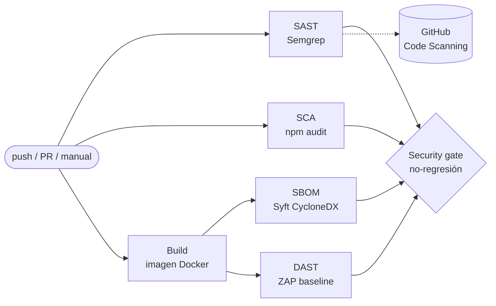

# Hito 2 · Pipeline DevSecOps
**Workflow:** [`.github/workflows/devsecops.yml`](../../.github/workflows/devsecops.yml)
**Security gate:** [`.github/security-gate/`](../../.github/security-gate/)
**Versión:** 1.0 · 2026-11-10

---

## 1. Resumen

Cada `push` a cualquier rama (y cada PR hacia `master`) ejecuta cuatro controles automáticos y un security gate:

| Control | Herramienta | Qué analiza | Artefacto |
|---|---|---|---|
| SAST | Semgrep 1.182.0 | Código fuente del backend (`routes/`, `lib/`, `models/`, `server.ts`) y del frontend Angular | `semgrep-report` (JSON + SARIF) |
| SCA | npm audit (npm 11.19.1) | Dependencias npm de producción del backend y del frontend | `sca-report` (JSON + lockfiles) |
| SBOM | Syft vía `anchore/sbom-action` v0.24.3 | Imagen Docker construida desde el código (`juice-shop:ci`) | `sbom-cyclonedx` (CycloneDX JSON) |
| DAST | ZAP 2.17.0 (`zap-baseline.py`) | La aplicación en ejecución, en un contenedor efímero del runner | `zap-report` (JSON, HTML, Markdown) |
| Gate | `gate.mjs` (Node, sin dependencias) | Compara los conteos con la línea base | `gate-result` + resumen del run |

El pipeline **arranca en modo reporte**: los escáneres nunca fallan por hallazgos y el gate solo informa. Después de fijar la línea base se pasa a **modo enforce** (ver §5).

Los workflows originales de Juice Shop (`ci.yml`, `codeql-analysis.yml`, `release.yml`, etc., 16 en total) se eliminaron.

> **Repositorio de trabajo.** El primer repositorio del grupo (`xtsebas/juice-shop`) tuvo un bloqueo de facturación de GitHub en la cuenta dueña que impidió iniciar cualquier job de Actions ("*The job was not started because your account is locked due to a billing issue*"), aunque el repositorio es público. El grupo trasladó el trabajo a **`josuemj/juice-shop`**, otro fork público de Juice Shop. Ese es el repositorio de trabajo desde el H2, y toda la evidencia de este hito se generó ahí.

## 2. Arquitectura del workflow

- `sast`, `sca` y `build` corren en paralelo. `sbom` y `dast` reutilizan la misma imagen, que pasa entre jobs como artefacto (retención de 1 día).
- La imagen se construye **desde el código del fork** con el `Dockerfile` del repo, no desde `bkimminich/juice-shop`. Así, en H4 el DAST y el SBOM reflejan las correcciones.
- `security-gate` corre siempre (`if: always()`), aunque falle un job anterior.
- **Endurecimiento del propio pipeline:**
  - Permisos mínimos (`contents: read`; `security-events: write` solo en SAST).
  - Acciones fijadas por SHA de commit.
  - Imágenes de herramientas fijadas por versión, elegidas con al menos 2 semanas de publicadas.
  - `concurrency` para cancelar corridas viejas.
  - Runner fijado en `ubuntu-24.04` (no `ubuntu-latest`), para que la migración de GitHub a Ubuntu 26 no cambie el entorno ni mueva los conteos del gate.
  - Sin secretos: ningún paso necesita tokens.

## 3. Controles

### 3.1 SAST · Semgrep

| Aspecto | Valor |
|---|---|
| Imagen | `semgrep/semgrep:1.182.0` |
| Rulesets del registro | `p/javascript`, `p/typescript`, `p/nodejsscan`, `p/owasp-top-ten`, `p/secrets` |
| Reglas propias | [`.semgrep/juice-shop.yml`](../../.semgrep/juice-shop.yml) |
| Exclusiones | [`.semgrepignore`](../../.semgrepignore) |
| Opciones | `--metrics=off` (no envía telemetría), `--timeout 30` (ver §6) |
| Salida | `semgrep.json` (para el gate) y `semgrep.sarif` (pestaña Security → Code scanning) |

**Reglas propias.** Se escribieron para que cada amenaza priorizada en H1 tenga una regla identificable en la matriz de trazabilidad ("¿Lo detectó el pipeline? Sí, SAST, regla …"). Se verificaron localmente contra el código:

| Regla | CWE / OWASP 2025 | Amenazas H1 | Detecta (verificado) |
|---|---|---|---|
| `juice-shop-sequelize-raw-query-interpolation` | CWE-89 · A05 | T-AUTH-01, T-CAT-01 | `routes/login.ts:34`, `routes/search.ts:23` |
| `juice-shop-marsdb-where-injection` | CWE-943 · A05 | T-CAT-02, T-NDB-02/03 | `routes/showProductReviews.ts:36`, `routes/trackOrder.ts:18`, `routes/chat.ts:149` |
| `juice-shop-hardcoded-private-key` | CWE-321 · A04 | T-AUTH-02 | `lib/insecurity.ts:21` |
| `juice-shop-angular-bypass-security-trust` | CWE-79 · A05 | T-SPA-01, T-SPA-03, T-CAT-05 | 9 usos, entre ellos `search-result.component.ts:113` y `:146`, y `track-result.component.ts:49` |

`juice-shop-hardcoded-private-key` existe porque **`p/secrets` no detectó** la llave RSA de `lib/insecurity.ts:21`: está en una sola línea con `\r\n` escapados. Es un ejemplo concreto de por qué no basta con los rulesets genéricos.

**Exclusiones (`.semgrepignore`) y su justificación:**

| Ruta | Motivo |
|---|---|
| `node_modules/`, `build/`, `dist/`, `frontend/dist/`, `frontend/.angular/`, `coverage/` | Código de terceros o generado; las dependencias se cubren con SCA |
| `test/`, `cypress/`, `*.spec.ts` | Pruebas, no se despliegan |
| `data/static/codefixes/`, `rsn/` | Variantes vulnerables y corregidas de los retos de código: no se ejecutan y duplicarían los hallazgos de las rutas reales |
| `infrastructure/`, `terraform/`, `vagrant/` | Inseguros a propósito y fuera de alcance (H1 §3.4) |
| `docs/`, `red-team/`, `blue-team/`, `*.md`, `*.pdf` | Entregables del proyecto; los payloads de las PoC generarían falsos positivos |

### 3.2 SCA · npm audit

| Aspecto | Valor |
|---|---|
| Herramienta | `npm audit --omit=dev --json`, con npm 11.19.1 sobre Node 24 |
| Alcance | `package.json` (backend) y `frontend/package.json`, solo dependencias de producción |
| Lockfile | Generado en el CI con `npm install --package-lock-only --ignore-scripts` |

- **Por qué npm audit y no Trivy:** viene con Node y no agrega una herramienta ni una acción de terceros al pipeline. Así se reduce la superficie de la cadena de suministro (A03:2025).
- **Por qué hay que generar el lockfile:** el repositorio no versiona lockfiles (`.npmrc`: `package-lock=false`), y npm audit los necesita. Se usa `--ignore-scripts` para que generarlos no ejecute código de dependencias. Los lockfiles generados se guardan en el artefacto como evidencia de qué versiones se auditaron.
- **Por qué npm 11.19.1:** con npm 10 la generación del lockfile del frontend falla (`Cannot read properties of null (reading 'edgesOut')`) por los `overrides` de `frontend/package.json`. 11.19.1 es la versión que usaba el CI original del proyecto.
- **Por qué `--omit=dev`:** el `Dockerfile` instala con `--omit=dev`, así que se audita lo que realmente se despliega.

### 3.3 SBOM · Syft (CycloneDX)

| Aspecto | Valor |
|---|---|
| Herramienta | Syft vía `anchore/sbom-action` v0.24.3 |
| Objetivo | Imagen `juice-shop:ci` (paquetes del sistema de la imagen distroless y `node_modules` de producción) |
| Formato | CycloneDX JSON (`sbom-juice-shop.cdx.json`) |
| Publicación | Artefacto `sbom-cyclonedx` en cada corrida; una copia de referencia en [`docs/hito-2/sbom/`](sbom/) |

Se genera sobre la **imagen**, no sobre el código, porque eso es lo que corre en producción. El gate verifica que el SBOM exista, que sea CycloneDX y que tenga componentes; si no, lo trata como reporte faltante.

### 3.4 DAST · ZAP baseline

| Aspecto | Valor |
|---|---|
| Imagen | `ghcr.io/zaproxy/zaproxy:2.17.0` |
| Comando | `zap-baseline.py -t http://localhost:3000 -j -m 3 -I` |
| Objetivo | Contenedor efímero `juice-shop:ci` en el runner de GitHub |
| Salida | `zap-report.json` (gate), `zap-report.html` y `zap-report.md` (lectura humana), `juice-shop.log` |

- `-j` agrega el spider AJAX, necesario porque Juice Shop es una SPA y el spider tradicional casi no encuentra rutas.
- `-m 3` limita el spider a 3 minutos.
- `-I` evita que las advertencias fallen el job.
- **Reglas de enfrentamiento:** el DAST solo ataca el contenedor que el propio job levanta en `localhost` del runner. Nunca apunta a `juice-shop.herokuapp.com` ni a otra instancia.

**Hallazgos High y Medium de la primera corrida y su relación con el H1:**

| Riesgo | Alerta ZAP (ID) | Amenaza / requisito H1 |
|---|---|---|
| High | Off-site Redirect (10028), en `/redirect` | T-CFG-05 redirección abierta |
| Medium | Cross-Domain Misconfiguration (10098), CORS `*` | T-CFG-04 CORS abierto |
| Medium | Content Security Policy Header Not Set (10038-1) | T-SPA-01 XSS (sin CSP como segunda barrera) |
| Medium | Missing Anti-clickjacking Header (10020-1) | Configuración de cabeceras (A02:2025) |
| Medium | Session ID in URL Rewrite (3-1) | T-SPA-02 robo de sesión |

Entre los Low aparece *Application Error Disclosure* (90022), que confirma T-CFG-03 (trazas de pila, RS-12).

## 4. Security gate: no-regresión (ratchet)

### 4.1 Por qué no un umbral de "cero hallazgos"

Juice Shop tiene decenas de vulnerabilidades **intencionales**. Un gate que bloquee ante cualquier hallazgo crítico fallaría en todos los pushes desde el primer día, y un gate que siempre falla se ignora o se desactiva. Un umbral numérico fijo (por ejemplo, "menos de 50") sería arbitrario y dejaría pasar vulnerabilidades nuevas sin que nadie lo note.

### 4.2 Criterio elegido

> **Ningún cambio puede empeorar la postura de seguridad.** El gate falla si alguna métrica controlada **sube** respecto de la línea base versionada.

- **La línea base se mide**, no se inventa: es el resultado de la primera corrida en modo reporte.
- **Sube solo con justificación.** Si se acepta un riesgo nuevo, el commit que modifica `baseline.json` lo explica y queda en el historial de git.
- **Baja con cada corrección (ratchet).** En H4, al corregir vulnerabilidades, los conteos bajan y la línea base se ajusta hacia abajo. Las vulnerabilidades corregidas ya no pueden volver sin que el gate falle.

### 4.3 Métricas controladas (bloquean en enforce)

| Métrica | Fuente | Por qué se controla |
|---|---|---|
| `sast.error` | Hallazgos de Semgrep con severidad `ERROR` | Inyecciones, XSS, secretos: las amenazas Críticas y Altas de H1 |
| `sca.backend.critical`, `sca.backend.high` | npm audit del backend | Dependencias explotables en el servidor |
| `sca.frontend.critical`, `sca.frontend.high` | npm audit del frontend | Dependencias explotables en el navegador |
| `dast.high`, `dast.medium` | **Tipos** de alerta distintos de ZAP con riesgo High o Medium | Configuración insegura observable en ejecución (cabeceras, divulgación de información) |

**Métricas informativas** (aparecen en el resumen pero no bloquean): `sast.warning`, `sast.info`, `sast.scan-errors`, `sca.*.moderate`, `sca.*.low`, `dast.low`, `dast.info` y `sbom.components`. Las severidades bajas generan mucho ruido y su riesgo está dentro del apetito definido en H1 §2.5 ("aceptable con monitoreo").

En ZAP se cuentan **tipos** de alerta (`alertRef`) y no instancias, porque el número de URLs que descubre el spider varía de una corrida a otra. Contar instancias produciría falsas regresiones.

### 4.4 Reglas del gate

| Situación | Modo `report` | Modo `enforce` |
|---|---|---|
| Métrica igual o menor que la línea base | Pasa | Pasa |
| Métrica mayor que la línea base | Pasa con advertencia | **Falla** |
| Falta un reporte (job caído, JSON inválido, SBOM vacío) | Pasa con advertencia | **Falla** (*fail-closed*) |
| Métrica sin línea base (`null`) | Se registra | **Falla** |

El resultado se publica en el resumen del run (*Job Summary*) como una tabla con línea base, valor actual y estado. Cuando algo baja, el resumen incluye la **línea base sugerida** lista para copiar.

### 4.5 Línea base vigente

Medida en la primera corrida en modo reporte: [run 43358600554](https://github.com/josuemj/juice-shop/actions/runs/43358600554) (2026-11-13 03:23 UTC, commit `30f1d17a6`).

| Métrica | Línea base |
|---|---:|
| `sast.error` | 40 |
| `sca.backend.critical` | 7 |
| `sca.backend.high` | 20 |
| `sca.frontend.critical` | 0 |
| `sca.frontend.high` | 1 |
| `dast.high` | 1 |
| `dast.medium` | 4 |

Métricas informativas de esa corrida:
- `sast.warning` 39, `sast.info` 4, `sast.scan-errors` 12.
- `sca.backend.moderate` 9, `sca.backend.low` 2, `sca.frontend.moderate` 2, `sca.frontend.low` 12.
- `dast.low` 8, `dast.info` 4.
- `sbom.components` 2743.

**Coherencia con la medición local previa:** en local (2026-11-10) Semgrep dio 45 `ERROR`. De ellos, 6 estaban en los workflows originales que se eliminaron, y después se agregó la regla `juice-shop-hardcoded-private-key` (+1): 45 − 6 + 1 = **40**. npm audit dio los mismos valores en local y en el CI.

## 5. Procedimiento: de modo reporte a enforce

1. **Primera corrida (modo `report`).** Hacer push y verificar que los 6 jobs terminen y que los artefactos existan.
2. **Fijar la línea base.** Copiar la "línea base sugerida" del resumen del run a `.github/security-gate/baseline.json` y anotar los valores y el link del run en §4.5. Copiar el SBOM a `docs/hito-2/sbom/`.
3. **Probar el gate.** En una rama temporal:
   1. Cambiar `mode` a `enforce` y agregar una SQLi de prueba (otra `sequelize.query` con interpolación).
   2. Verificar que `sast.error` sube y que el gate falla en rojo.
   3. Revertir y verificar que vuelve a verde.
   4. Registrar ambos runs en §7.
4. **Activar enforce.** Hacer un commit que cambie `"mode": "enforce"` y registrarlo en §7 con fecha y hash.

**Actualizar la línea base después de enforce:**
- **Hacia abajo** (se corrigió algo): copiar la línea base sugerida; el commit indica qué se corrigió.
- **Hacia arriba** (riesgo aceptado, por ejemplo una CVE nueva sin parche): el commit explica el motivo, el responsable y cuándo se revisará. Se registra como riesgo residual en el informe final.

## 6. Limitaciones conocidas

| Limitación | Efecto | Mitigación |
|---|---|---|
| El lockfile se resuelve en cada corrida (el repo no lo versiona) | Las versiones auditadas pueden cambiar entre corridas sin cambios en el código | Se guardan los lockfiles en el artefacto; si una versión nueva trae una CVE, que el gate falle es lo deseado |
| La base de advisories de npm y los rulesets del registro de Semgrep cambian con el tiempo | Un conteo puede subir sin cambios en el código | Se trata como un hallazgo nuevo: revisar y corregir, o aceptar con justificación |
| Semgrep tiene timeouts por archivo en archivos grandes | El número de hallazgos podría variar según la velocidad del runner | `--timeout 30` (en lugar de 5 s por defecto); `sast.scan-errors` se reporta para detectarlo |
| ZAP baseline es pasivo | No detecta inyecciones (SQLi, XSS) ni control de acceso roto | Esas amenazas se cubren con SAST y con las PoC del Red Team; el WAF y el SIEM en H3 |
| El DAST corre sin el WAF | Mide la aplicación, no la defensa en profundidad | Es intencional: el WAF ocultaría los hallazgos de la aplicación; la defensa se prueba en H3 |
| SARIF en Code Scanning | Requiere repositorio público o GitHub Advanced Security | El paso es `continue-on-error`; el JSON del artefacto es la fuente del gate |

## 7. Evidencia

| Fecha | Evento | Run / commit |
|---|---|---|
| 2026-11-12 | Primer intento en el repo oficial: no inicia por bloqueo de facturación de la cuenta dueña | [run 43357748954](https://github.com/xtsebas/juice-shop/actions/runs/43357748954) |
| 2026-11-12 | Primera corrida en modo reporte: 6 jobs en verde, 11 min | [run 43358600554](https://github.com/josuemj/juice-shop/actions/runs/43358600554) · `30f1d17a6` |
| 2026-11-12 | Línea base fijada (modo reporte, runner `ubuntu-24.04`): las 7 métricas iguales a la línea base | [run 43361246603](https://github.com/josuemj/juice-shop/actions/runs/43361246603) · `ad47e4ad8` |
| 2026-11-12 | **Prueba del gate: regresión bloqueada.** Rama `test/gate-regresion`, modo `enforce` + SQLi canario en `routes/gateCanary.ts`. La regla `juice-shop-sequelize-raw-query-interpolation` la detecta (`gateCanary.ts:5`), `sast.error` sube de 40 a 41 y el job *Security gate* falla con "Regresión sast.error: 40 → 41". Los 5 escáneres terminan en verde: falla solo el gate | [run 43362314706](https://github.com/josuemj/juice-shop/actions/runs/43362314706) · `c3be2946c` |
| 2026-11-12 | **Prueba del gate: vuelve a verde.** Misma rama, se elimina el canario. En modo `enforce` las 7 métricas vuelven a la línea base (`sast.error` 40) y los 6 jobs terminan en verde | [run 43363597319](https://github.com/josuemj/juice-shop/actions/runs/43363597319) · `b510a83fa` |
| *pendiente* | Cambio a modo enforce | |

## 8. Trazabilidad con H1

| Requisito H1 | Cómo lo verifica el pipeline |
|---|---|
| RS-01 Consultas parametrizadas | Reglas `juice-shop-sequelize-raw-query-interpolation` y `juice-shop-marsdb-where-injection`, más `p/nodejsscan` |
| RS-02 Sin `bypassSecurityTrustHtml` sobre datos del usuario | Regla `juice-shop-angular-bypass-security-trust` |
| RS-04 Sin llaves privadas en el repositorio | Regla `juice-shop-hardcoded-private-key` y `p/secrets` |
| RS-10 Sin `eval` / `vm` sobre entrada | `p/javascript`, `p/nodejsscan` |
| RS-11 Sin listados de directorio ni endpoints sensibles abiertos | DAST (ZAP) |
| RS-12 Sin trazas de pila en errores | DAST (ZAP) |
| RS-21 Secretos fuera del repositorio | `p/secrets` |
| RS-24 Pipeline con SAST, SCA, SBOM, DAST y gate | Este workflow |
