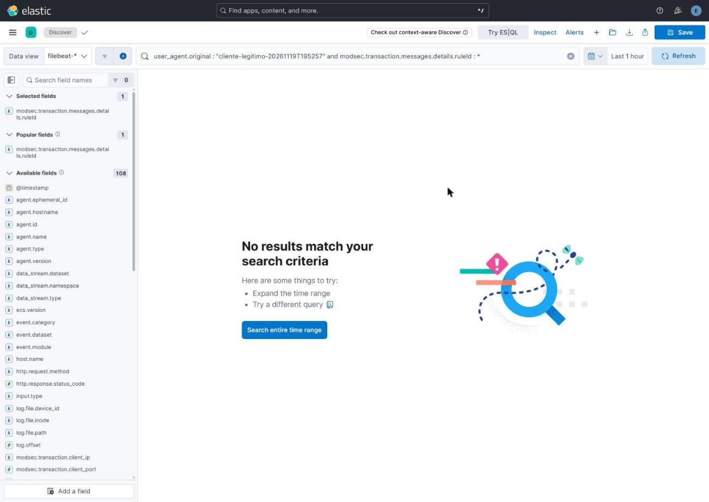
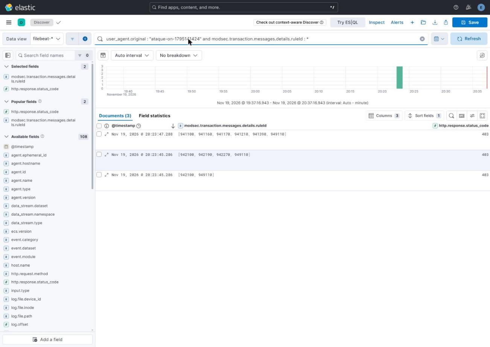
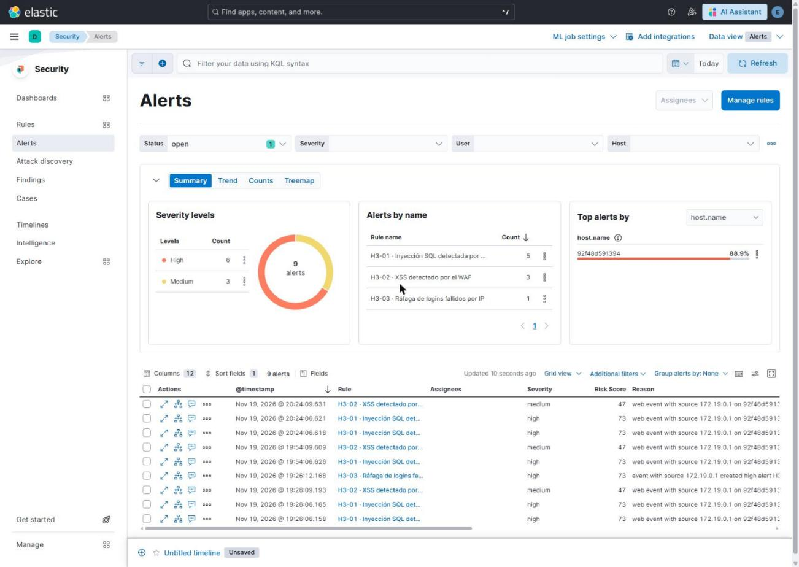
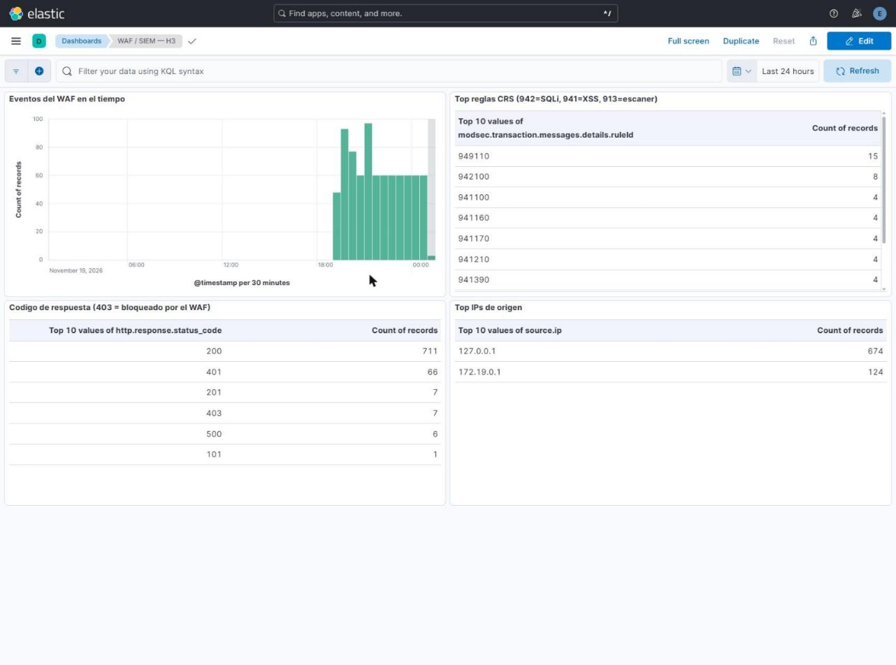

# Hito 3 · Detección y respuesta - Blue Team

## 1. Resumen

**logs del WAF en Elastic, reglas de detección, WAF en DetectionOnly y luego en On, con los falsos positivos documentados y ajustados**.

Orden:

1. **DetectionOnly** (el WAF registra, no bloquea) → se genera tráfico legítimo y se observan los **falsos positivos** en Kibana.
2. Se **ajusta** el WAF con exclusiones específicas para cada falso positivo.
3. Se verifica en DetectionOnly que el tráfico legítimo ya no dispara reglas, sin perder la detección de ataques.
4. Se pasa el WAF a **On** (bloquea con 403) y se comprueba que el cliente legítimo no se bloquea y que los ataques sí.

## 2. Reglas de detección en el SIEM

[`blue-team/reglas-siem/`](../../blue-team/reglas-siem/) y se cargan en Kibana con [`cargar-reglas.sh`](../../blue-team/reglas-siem/cargar-reglas.sh).

| Regla (Kibana) | Tipo | Lógica | Detecta |
|---|---|---|---|
| **H3-01 · Inyección SQL** | Query | `tags:"waf" and ...ruleId : 942*` | V-01 (SQLi login), V-02 (SQLi UNION) |
| **H3-02 · XSS** | Query | `tags:"waf" and ...ruleId : 941*` | V-03 (XSS) |
| **H3-03 · Ráfaga de logins por IP** | Threshold | ≥20 respuestas 401 en `/rest/user/login` por `source.ip` en 1 min | V-06 (fuerza bruta) |
| **H3-04 · IDOR: carrito ajeno** | ES\|QL | `GET /rest/basket/{id}` con `id` ≠ `jwt.bid` (el carrito que el login asignó al usuario) | V-04 (IDOR carrito) |
| **H3-05 · JWT no emitido por la app** | Query | `jwt.alg` ≠ RS256, sin firma, encabezado ≠ `typ,alg` o `jwt.claims` sin `createdAt` | V-05 (JWT forjado) |

Verlas en Kibana: **☰ → Security → Rules → Detection rules (SIEM)**. Las alertas: **Security → Alerts**.

H3-01 a H3-03 cubren el mínimo del enunciado (SQLi, XSS y ráfagas por IP). H3-04 y H3-05 se agregaron para que **todas** las PoC del Red Team tengan detección en el SIEM (columna "¿Lo detectó el SIEM?" de la matriz de trazabilidad).

### 2.1 Ataques sin payload: el JWT en Filebeat

V-04 y V-05 son peticiones válidas (200 OK) que el CRS no puede marcar: no hay nada malicioso en la URL ni en el cuerpo. La señal está en el **token**. Por eso [`filebeat.yml`](../../entorno-blue-team/filebeat/filebeat.yml) decodifica el JWT (header `Authorization` o cookie `token`) **antes** de enmascararlo y guarda en `jwt.*` solo metadatos:

| Campo | Ejemplo legítimo | Token forjado (V-05) |
|---|---|---|
| `jwt.alg` | `RS256` | `RS256` |
| `jwt.header_orden` | `typ,alg` (orden en que lo escribe la librería `jsonwebtoken`) | `alg,typ` |
| `jwt.claims` | `id … createdAt, updatedAt, deletedAt` (la app copia la fila completa de la BD) | sin `createdAt`/`updatedAt`/`password` |
| `jwt.role` / `jwt.user_id` / `jwt.bid` | `customer` / `26` / `7` | `admin` / `1` / `1` |

Nunca se guarda el email, el hash de contraseña ni la firma, y el token en `modsec.*` sigue como `<encabezado>.[REDACTED]` (RS-19). La firma **no** se verifica: el SIEM no tiene ni debe tener la llave.

**Límite de H3-05:** la detección es heurística (huella del emisor), no criptográfica. El H1 indicaba que un token firmado con la llave filtrada "no es detectable", y eso sigue siendo cierto si el atacante copia el orden del encabezado y todos los claims de un token real. La única contención definitiva es rotar la llave (RS-04, H4).

## 3. Falsos positivos documentados

En DetectionOnly se generó tráfico de un cliente normal con [`generar-trafico-legitimo.sh`](../../blue-team/falsos-positivos/generar-trafico-legitimo.sh) (registro, búsqueda, carrito, reseña, feedback, perfil).

Se observaron **3 falsos positivos**, los tres alcanzando el score de anomalía 5 (regla `949110`), es decir, en modo On los tres habrían devuelto **403 y roto la tienda** para un usuario real:

| # | Regla CRS | Petición legítima | Causa |
|---|---|---|---|
| FP-1 | **911100** · Method is not allowed by policy | `PUT /rest/products/:id/reviews` | El CRS solo permite GET/HEAD/POST/OPTIONS por defecto; Juice Shop es una API REST y usa PUT/PATCH/DELETE de forma legítima |
| FP-2 | **932260** · Remote Command Execution (Unix) | `GET /rest/user/whoami` | La ruta contiene la palabra `whoami`, que es un comando Unix: la regla la marca por el **nombre del endpoint**, no por un ataque |
| FP-3 | **920420** · Request content type is not allowed | `POST /socket.io/...` | El canal de notificaciones en tiempo real de la tienda hace polling con un content-type que la regla no permite |

## 4. Ajustes aplicados

Por cada falso positivo se escribió una exclusión en [`entorno-blue-team/waf/REQUEST-900-EXCLUSION-RULES-BEFORE-CRS.conf`](../../entorno-blue-team/waf/REQUEST-900-EXCLUSION-RULES-BEFORE-CRS.conf) (IDs 1001–1003). El archivo se monta dentro del WAF, así que las exclusiones se aplican solas al levantar el entorno y siguen activas tanto en DetectionOnly como en On.

| Exclusión | Qué hace | Por qué NO abre la puerta al Red Team |
|---|---|---|
| **1001** (FP-1) | Amplía los métodos permitidos a GET/HEAD/POST/OPTIONS/PUT/PATCH/DELETE | Todas las PoC del Red Team usan solo GET/POST; permitir PUT/PATCH/DELETE no habilita ninguna |
| **1002** (FP-2) | Quita **solo** la regla 932260 y **solo** en `/rest/user/whoami` | Ninguna PoC pasa por `/rest/user/whoami`; el resto de reglas RCE siguen activas en todo el sitio |
| **1003** (FP-3) | Quita **solo** la regla 920420 y **solo** en `/socket.io/` | Ninguna PoC pasa por `/socket.io/`; la validación de content-type sigue activa en el resto de rutas |

Tras aplicar las exclusiones, un ataque de control de SQLi siguió disparando `942100` y uno de XSS siguió disparando la familia `941xxx`. Las exclusiones eliminan los falsos positivos sin afectar la detección de ataques reales.

## 5. Evidencia (5 escenarios)

Cada escenario tiene un **marcador** en el `User-Agent` para filtrarlo exactamente en Kibana. Las horas están en UTC (en Kibana, ajustar el rango de tiempo a la ventana indicada; Kibana muestra hora local America/Guatemala = UTC−6).

### S1 - DetectionOnly - ANTES del ajuste (3 falsos positivos)

Tráfico legítimo con el WAF en DetectionOnly y **sin** exclusiones. Se ven las reglas `911100` y `932260` sobre peticiones legítimas (y `920420` sobre el `/socket.io/` que genera la propia app).

- **KQL:** `user_agent.original : "cliente-legitimo-20261119T194941" and modsec.transaction.messages.details.ruleId : *`
- **Rango:** 2026-11-19 19:49:40 – 19:50:10 (hora local)
- **Resultado esperado en la captura:** eventos con `ruleId` 911100 y 932260 sobre `/rest/products/*/reviews` y `/rest/user/whoami`.


### S2 - DetectionOnly - DESPUÉS del ajuste (0 falsos positivos)

Mismo tráfico legítimo, con las exclusiones ya aplicadas. No aparece ninguna regla.

- **KQL:** `user_agent.original : "cliente-legitimo-20261119T195257" and modsec.transaction.messages.details.ruleId : *`
- **Rango:** 2026-11-19 19:53:00 – 19:53:30 (hora local)



### S3 - Modo On - tráfico legítimo NO se bloquea

WAF en On (bloqueo). Tráfico legítimo: ninguna petición recibe 403.

- **KQL:** `user_agent.original : "cliente-legitimo-20261119T202339"`
- **Rango:** 2026-11-19 20:23:40 – 20:24:00 (hora local)


### S4 - Modo On - ataques BLOQUEADOS y alertados

WAF en On. Ataques SQLi y XSS: los tres reciben **403** y disparan las reglas del SIEM.

- **KQL (eventos del WAF):** `user_agent.original : "ataque-on-*" and http.response.status_code : 403`
- **Captura de alertas:** **☰ → Security → Alerts**, rango 2026-11-19 20:23:45 – 20:24:00.

| Ataque | Ruta | HTTP | Alerta SIEM |
|---|---|---|---|
| V-01 SQLi login | `/rest/user/login` | 403 | H3-01 · Inyección SQL |
| V-02 SQLi UNION | `/rest/products/search` | 403 | H3-01 · Inyección SQL |
| V-03 XSS | `/rest/products/search` | 403 | H3-02 · XSS |




### S5 - Modo On - las 6 PoC del Red Team, detectadas por las 5 reglas

WAF en On. Corrida completa de [`run-h3.sh`](../../red-team/poc/h3-waf/run-h3.sh): V-01 a V-03 reciben 403, y V-04 a V-06 pasan (el WAF no puede verlas), pero las alerta el SIEM.

- **Marcador:** `redteam-h3-20261121T043234` · **KQL:** `user_agent.original : redteam-h3-20261121T043234*`
- **Rango:** 2026-11-21 04:32:30 – 04:33:40 UTC (22:32:30 – 22:33:40 del 2026-11-20, hora local)
- **Evidencia exportada:** [`alertas-siem-redteam-h3-20261121T043234.csv`](evidencia-siem/alertas-siem-redteam-h3-20261121T043234.csv) (alertas) y [`waf-redteam-h3-20261121T043234.csv`](evidencia-siem/waf-redteam-h3-20261121T043234.csv) (eventos del WAF, con `jwt.*`)

| Ataque | Ruta | HTTP | Alerta SIEM |
|---|---|---|---|
| V-01 SQLi login | `/rest/user/login` | 403 | H3-01 · Inyección SQL |
| V-02 SQLi UNION | `/rest/products/search` | 403 | H3-01 · Inyección SQL |
| V-03 XSS | `/rest/track-order/<iframe…>` | 403 | H3-02 · XSS |
| V-04 IDOR carrito | `/rest/basket/1` (su carrito es el 7) | 200 | **H3-04 · IDOR** (`carrito_solicitado`=1, `jwt.bid`=7) |
| V-05 JWT forjado | `/api/Users/?size=3` | 200 | **H3-05 · JWT** (`header_orden`=`alg,typ`, sin `createdAt`, `role`=admin) |
| V-06 Fuerza bruta | `/rest/user/login` ×30 | 401 | H3-03 · Ráfaga de logins |

**Falsos positivos de H3-04/H3-05:** justo después se corrió el tráfico legítimo (`cliente-legitimo-20261120T223421`). Sus 4 peticiones autenticadas (carrito propio `/rest/basket/8`, `BasketItems`, reseña y feedback) llegaron con `typ,alg`, `createdAt` y `jwt.bid`=8, y generaron **0 alertas**.

## 6. Resultado

| | DetectionOnly | Modo On |
|---|---|---|
| **Cliente legítimo, antes del ajuste** | 3 falsos positivos (S1) | (habría dado 403: no se llega a este punto) |
| **Cliente legítimo, después del ajuste** | 0 falsos positivos (S2) | 0 bloqueos (S3) |
| **Ataques SQLi/XSS** | detectados, pasan (DetectionOnly no bloquea) | **403 bloqueados + alertados** (S4, S5) |
| **Ataques sin payload (IDOR, JWT, fuerza bruta)** | pasan, alertados | pasan (el WAF no puede verlos), **alertados** (S5); se corrigen en el código (H4) |

El WAF quedó ajustado: bloquea los ataques del perímetro sin estorbar al cliente legítimo, y el SIEM genera alertas con hora, IP, ruta y regla.

## 7. Cómo Reproducir

```bash
# 1. Entorno  /entorno-blue-team
docker compose up -d && ./verificar.sh

# 2. Reglas de detección en Kibana (también declara el mapeo jwt.*)
#    Si el entorno ya estaba levantado antes del cambio en filebeat.yml:
#    cd entorno-blue-team && docker compose restart filebeat
bash blue-team/reglas-siem/cargar-reglas.sh

# 3. Tráfico legítimo
bash blue-team/falsos-positivos/generar-trafico-legitimo.sh

# 4. Cambiar el WAF a modo On (bloqueo) para la demo
#    en entorno-blue-team/.env: MODSEC_RULE_ENGINE=On
cd entorno-blue-team && docker compose up -d --force-recreate waf

# 5. Importar el dashboard a Kibana (ver §8)
P=$(grep ^ELASTIC_PASSWORD entorno-blue-team/.env | cut -d= -f2)
curl -s -u "elastic:$P" -H 'kbn-xsrf: true' \
  -F file=@blue-team/consultas/dashboard-waf-h3.ndjson \
  "http://localhost:5601/api/saved_objects/_import?overwrite=true"
```

## 8. Dashboard del WAF / SIEM

Dashboard **"WAF / SIEM — H3"** en Kibana, sobre el data view `filebeat-*`, con 4 paneles:

| Panel | Qué muestra |
|---|---|
| Eventos del WAF en el tiempo | Volumen de peticiones registradas por el WAF (barras sobre `@timestamp`) |
| Top reglas CRS | Reglas disparadas (`942`=SQLi, `941`=XSS, `913`=escáner…) por frecuencia |
| Código de respuesta | `http.response.status_code`: **403 = bloqueado** por el WAF vs. el resto |
| Top IPs de origen | `source.ip` con más actividad |


