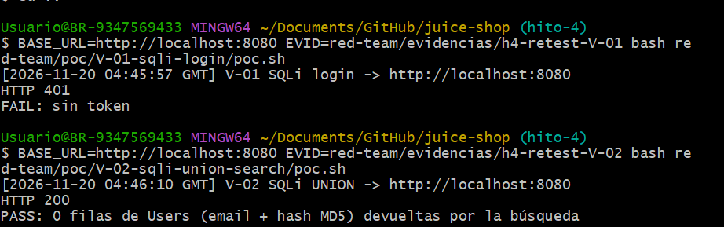
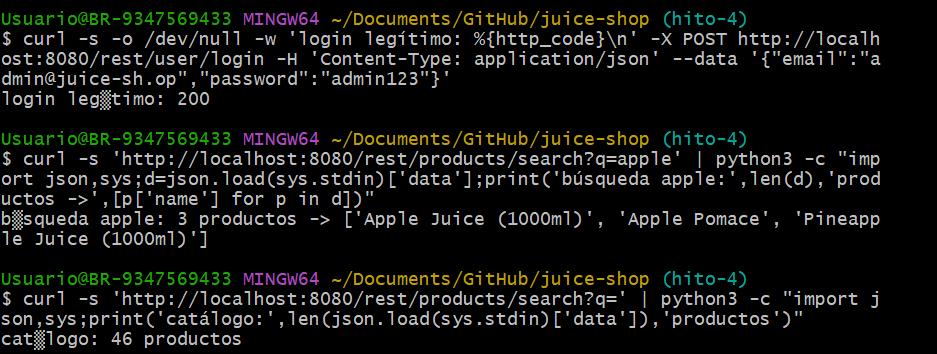
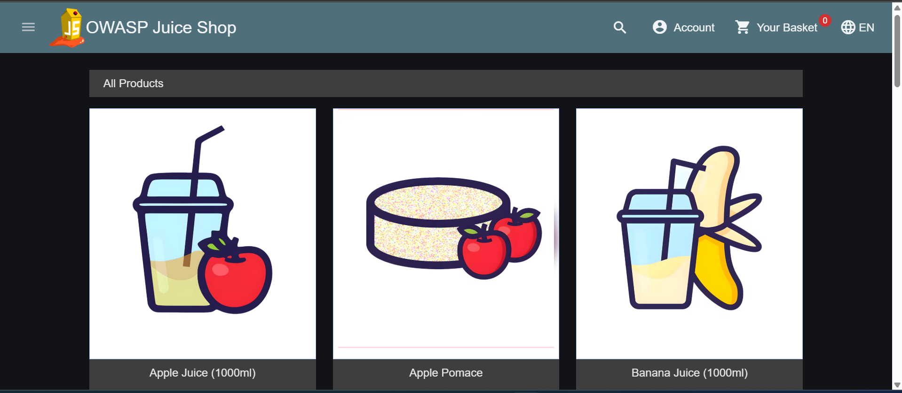

# Hito 4 · Remediación con IA (V-01 y V-02)

**Rama:** `hito-4` · **Fecha de la re-prueba:** 2026-11-19
**Registro de uso de IA:** [`docs/ia/h4-remediacion-sqli.md`](../ia/h4-remediacion-sqli.md) · **Plan:** [`plan-h4.md`](plan-h4.md)

---

## 1. Resumen

Se corrigieron **en el código** las dos inyecciones SQL explotadas en H2, con ayuda de un asistente de IA (Claude Code), y se auditó el código generado antes de integrarlo.

| ID | Vulnerabilidad | Archivo | Antes (H2) | Después (H4) |
|---|---|---|---|---|
| **V-01** | SQLi en el login | `routes/login.ts:34` | HTTP 200, JWT de `admin@juice-sh.op` (rol `admin`) | **HTTP 401, sin token** |
| **V-02** | SQLi UNION en la búsqueda | `routes/search.ts:23` | HTTP 200, **25 usuarios** exfiltrados (correo y hash MD5) | **HTTP 200, 0 filas** |

La re-prueba se hizo con el WAF en **DetectionOnly**: el WAF registró los ataques pero no los bloqueó. Lo que los frenó fue **el código corregido**, no el WAF. La tienda siguió funcionando: login legítimo, búsqueda y catálogo completo.

## 2. Cambios en el código

Las dos consultas pasan de interpolar la entrada del usuario dentro del SQL a **consultas parametrizadas de Sequelize**. No se agregaron dependencias.

### V-01 · `routes/login.ts:34` (parámetros `bind`)

```diff
-    models.sequelize.query(`SELECT * FROM Users WHERE email = '${req.body.email || ''}' AND password = '${security.hash(req.body.password || '')}' AND deletedAt IS NULL`, { model: UserModel, plain: true })
+    models.sequelize.query('SELECT * FROM Users WHERE email = $1 AND password = $2 AND deletedAt IS NULL', { bind: [req.body.email || '', security.hash(req.body.password || '')], model: UserModel, plain: true })
```

La consulta es un texto fijo con `$1` y `$2`. El correo y el hash viajan aparte como parámetros, así que la base de datos nunca los interpreta como SQL: la comilla de `' OR 1=1--` se compara como parte del correo y no cierra la cadena.

### V-02 · `routes/search.ts:23` (parámetros `replacements`)

```diff
-    models.sequelize.query(`SELECT * FROM Products WHERE ((name LIKE '%${criteria}%' OR description LIKE '%${criteria}%') AND deletedAt IS NULL) ORDER BY name`)
+    models.sequelize.query('SELECT * FROM Products WHERE ((name LIKE :criteria OR description LIKE :criteria) AND deletedAt IS NULL) ORDER BY name', { replacements: { criteria: `%${criteria}%` } })
```

La consulta también es fija. Sequelize inserta el valor como un literal de texto escapado, así que `qwert'))` no puede cerrar los paréntesis ni agregar el `UNION`. Los comodines `%` van en el **valor** y no dentro de la consulta: el codefix de referencia de Juice Shop (`LIKE '%:criteria%'`) deja el marcador entre comillas y, con Sequelize 6.37, la búsqueda devuelve 0 productos siempre (ver §3).

Commit: `fix(h4): consultas parametrizadas en login y búsqueda (V-01, V-02)` · hash: `288cb16ce`

## 3. Auditoría del código generado por IA

El detalle (prompt, respuesta textual y decisiones) está en [`docs/ia/h4-remediacion-sqli.md`](../ia/h4-remediacion-sqli.md). Resumen:

| Control | Resultado |
|---|---|
| **Revisión manual** | Diff de una línea por archivo; consulta parametrizada; sin nuevas rutas de concatenación; se conservan el manejo de errores, el truncado a 200 caracteres y los bloques de los retos |
| **Hallazgo 1 · fix de referencia roto** | Se rechazó el patrón `LIKE '%:criteria%'` (codefix `unionSqlInjectionChallenge_2_correct.ts`): con Sequelize 6.37.7 devuelve 0 productos para cualquier búsqueda, incluida la vacía que carga el catálogo. Eliminaba la inyección, pero rompía la tienda |
| **Hallazgo 2 · instrucciones del repositorio para IA** | `AGENTS.md` pide correr el RSN y actualizar `data/static/codefixes/` al tocar código de un reto, para conservar las vulnerabilidades intencionales. El prompt las anuló de forma explícita; el asistente modificó solo `routes/login.ts` y `routes/search.ts` |
| **Hallazgo 3 · impacto en retos** | El fix rompe los retos `loginAdminChallenge`, `unionSqlInjectionChallenge` y `dbSchemaChallenge`. Es esperado: el objetivo del fork es eliminar la vulnerabilidad |
| **Slopsquatting** | Sin dependencias nuevas: `package.json` y `frontend/package.json` no cambian, y el SBOM del run #16 sigue en 2743 componentes (`sbom.components`, igual que en H2) |
| **Secretos** | Los cambios no agregan credenciales, llaves ni tokens. En el pipeline, `sast.error` no subió (40 → 36), así que no hay hallazgos nuevos de severidad `ERROR` que indiquen un secreto, y `sast.warning` sigue en 39 (igual que en H2), sin hallazgos nuevos de severidad `WARNING`. El dato es el conteo agregado, no una revisión hallazgo por hallazgo (§6) |
| **Compilación** | La imagen se construyó desde el código del fork sin errores, lo que confirma que el TypeScript corregido compila |
| **SAST** | `sast.error` bajó de 40 a 36 en el run #16 por la corrección de V-01 y V-02 (§6) |

## 4. Re-prueba de las PoC

### 4.1 Condiciones

| Condición | Cómo se verificó |
|---|---|
| Juice Shop construido **desde el código corregido** del fork | `docker compose up -d --build juice-shop` con el bloque `build:` del `docker-compose.yml`. `docker compose images juice-shop` muestra la imagen local `juice-shop-blue-juice-shop` (no `bkimminich/juice-shop:v20.3.0`) |
| Ataques **a través del WAF** | `BASE_URL=http://localhost:8080`; la tienda responde 200 por el WAF |
| WAF en **DetectionOnly** (no bloquea) | `docker compose exec waf printenv MODSEC_RULE_ENGINE` → `DetectionOnly` |
| Evidencia separada de la de H2 | `EVID=red-team/evidencias/h4-retest-V-0x` |

El cambio a `build:` en el `docker-compose.yml` fue solo para esta prueba local y no se versiona: el entorno del repositorio sigue usando la imagen publicada.

### 4.2 Comandos

```bash
# Git Bash, desde la raíz del repositorio
BASE_URL=http://localhost:8080 EVID=red-team/evidencias/h4-retest-V-01 bash red-team/poc/V-01-sqli-login/poc.sh
BASE_URL=http://localhost:8080 EVID=red-team/evidencias/h4-retest-V-02 bash red-team/poc/V-02-sqli-union-search/poc.sh
```

### 4.3 Resultado

| PoC | Payload | Antes (H2) | Después (H4) | Evidencia |
|---|---|---|---|---|
| V-01 | `{"email":"' OR 1=1--","password":"x"}` en `POST /rest/user/login` | 200 + JWT de admin | **401, sin token** ✅ | [`red-team/evidencias/h4-retest-V-01/`](../../red-team/evidencias/h4-retest-V-01/) |
| V-02 | `qwert')) UNION SELECT id, email, password, '4','5','6','7','8','9','10' FROM Users--` en `GET /rest/products/search?q=` | 200 + 25 usuarios | **200, 0 filas** ✅ | [`red-team/evidencias/h4-retest-V-02/`](../../red-team/evidencias/h4-retest-V-02/) |

Los mensajes de los scripts están escritos desde el punto de vista del atacante: en V-01, `FAIL: sin token` significa que **el ataque falló**; en V-02, `PASS: 0 filas` significa que **no se exfiltró nada**.

**Hora:** 2026-11-19, 22:45:57 (V-01) y 22:46:10 (V-02), hora de Guatemala (UTC−6). Los scripts imprimen la hora en UTC (`2026-11-20 04:45:57 GMT`) porque Git Bash en Windows ignora la zona horaria del script.



## 5. Control funcional (la tienda sigue funcionando)

Un fix de seguridad que rompe la funcionalidad no es aceptable, y "0 filas" en V-02 también saldría si la búsqueda estuviera rota (como con el codefix de referencia). Por eso se probaron los casos legítimos en las mismas condiciones:

| Caso legítimo | Esperado | Resultado |
|---|---|---|
| Login con `admin@juice-sh.op` / `admin123` | 200 con token | **200** ✅ |
| Búsqueda `q=apple` | Al menos 1 producto | **3 productos**: Apple Juice (1000ml), Apple Pomace, Pineapple Juice (1000ml) ✅ |
| Búsqueda vacía `q=` (la que usa la tienda para cargar el catálogo) | Catálogo completo | **46 productos** ✅ |
| Tienda en el navegador (`http://localhost:8080`) | Se ve el catálogo | Se ve "All Products" con sus productos ✅ |





## 6. Pipeline y security gate

| Verificación | Esperado | Resultado |
|---|---|---|
| Run de *DevSecOps* en la rama `hito-4` | 6 jobs en verde | **6 jobs en verde** ✅ (gate en modo reporte) · [run #16 (44679006959)](https://github.com/josuemj/juice-shop/actions/runs/44679006959) |
| `sast.error` | Menor que la línea base (40); sin hallazgos en `login.ts:34` ni `search.ts:23` | **40 → 36** ✅, por la corrección de V-01 y V-02 |
| Escaneo de secretos (`p/secrets`, `juice-shop-hardcoded-private-key`) | Sin hallazgos nuevos | `sast.error` no subió (40 → 36): no hay hallazgos nuevos de severidad `ERROR` que indiquen un secreto (ahí cuenta `juice-shop-hardcoded-private-key`). El dato es el conteo agregado, no una revisión hallazgo por hallazgo; las reglas de `p/secrets` con severidad `WARNING` cuentan en `sast.warning`, que sigue en 39 (igual que en H2): tampoco hay hallazgos nuevos de severidad `WARNING` |
| Ratchet: `baseline.json` actualizado al nuevo `sast.error` | Commit con la justificación | `sast.error` 40 → 36 (fix de H4) y `sca.backend.high` 20 → 16 (resolución de dependencias en el CI, no H4). `dast.high` se mantiene en 1 aunque el run dio 0: es una variación del spider de ZAP con `/redirect`, que sigue en el código. Detalle en [`pipeline-devsecops.md` §4.5](../hito-2/pipeline-devsecops.md) · commit `a9e48e06a` |
| Gate en `"mode": "enforce"` | Run final en verde | **"Modo: enforce · Resultado: PASA"** ✅, 6 jobs en verde, las 7 métricas controladas iguales a la línea base · [run #17 (44681610092)](https://github.com/josuemj/juice-shop/actions/runs/44681610092) |
| `dast.high` en el run #17 | 1 (línea base) | **1**: ZAP volvió a encontrar `/redirect` sin ningún cambio en el código (en el run #16 había dado 0). Con línea base 0, este run habría fallado en `enforce`; confirma la decisión de mantenerlo en 1. También variaron `dast.low` (7 → 8) y `dast.info` (4 → 6) entre los dos runs |

## 7. Matriz de trazabilidad (V-01 y V-02)

| Hallazgo | OWASP / CWE | CVSS v3.1 | ¿Lo detectó el pipeline? | ¿Lo detectó el SIEM? | ¿Lo bloqueó el WAF? | Corrección | Re-prueba |
|---|---|---|---|---|---|---|---|
| V-01 SQLi en login | A05:2025 / CWE-89 | 9.8 `AV:N/AC:L/PR:N/UI:N/S:U/C:H/I:H/A:H` | Sí, SAST (regla `juice-shop-sequelize-raw-query-interpolation`, `login.ts:34`) | Sí, regla H3-01 · Inyección SQL (CRS 942xxx) | Sí, 403 en modo On (H3, S4) | Consulta parametrizada con `bind` (IA, auditado) · commit `288cb16ce` | La PoC falla: 401 sin token, con WAF en DetectionOnly (2026-11-19 22:45) |
| V-02 SQLi UNION | A05:2025 / CWE-89 | 7.5 `AV:N/AC:L/PR:N/UI:N/S:U/C:H/I:N/A:N` | Sí, SAST (regla `juice-shop-sequelize-raw-query-interpolation`, `search.ts:23`) | Sí, regla H3-01 · Inyección SQL (CRS 942xxx) | Sí, 403 en modo On (H3, S4) | Consulta parametrizada con `replacements` (IA, auditado; se rechazó el codefix de referencia) · commit `288cb16ce` | La PoC falla: 0 filas, con WAF en DetectionOnly (2026-11-19 22:46); búsqueda legítima intacta |

## 8. Notas

- **Retos rotos a propósito:** el fix rompe `loginAdminChallenge`, `unionSqlInjectionChallenge` y `dbSchemaChallenge`. No se mantiene la solvencia de los retos ni el RSN de Juice Shop (su workflow se eliminó en H2): el objetivo es eliminar la vulnerabilidad.
- **Tests unitarios de Juice Shop:** algunos esperan que la inyección funcione; no corren en nuestro pipeline, así que no bloquean.
- **Defensa en profundidad:** con el código corregido, el WAF y la regla H3-01 siguen activos como segunda capa: un intento de inyección se sigue registrando y alertando aunque ya no tenga efecto. Se puede comprobar en Kibana filtrando `url.original : "/rest/user/login" and modsec.transaction.messages.details.ruleId : 942*` en el rango de la re-prueba.
- **Comodines de LIKE:** una búsqueda con `%` o `_` sigue funcionando como comodín (por ejemplo, `100%`). Ya pasaba antes y no es una inyección: solo cambia qué productos coinciden, no la consulta.
